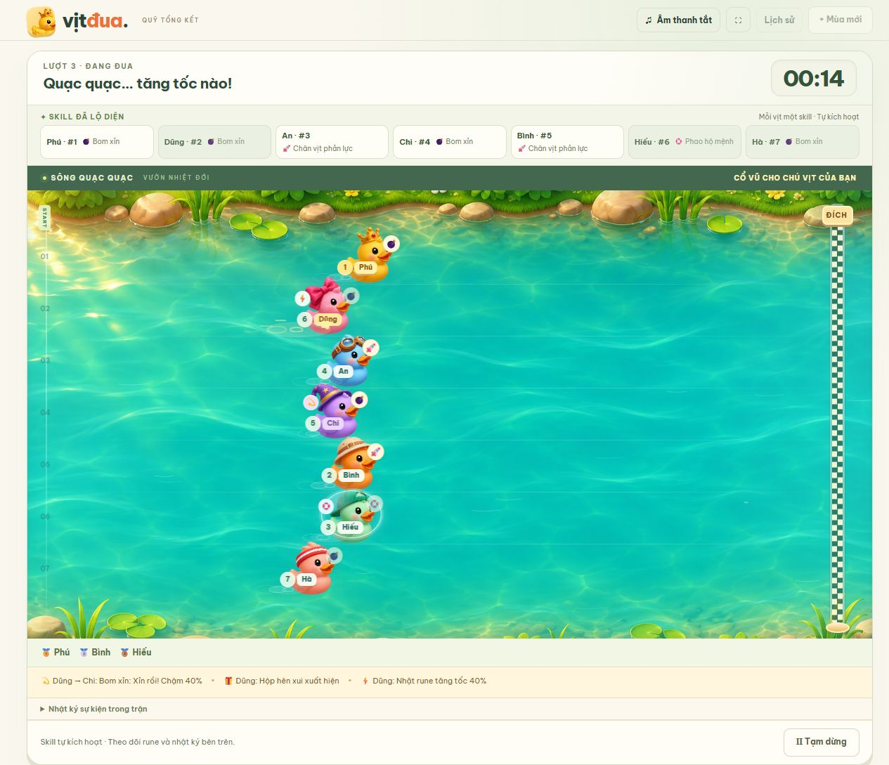

# 🦆 Vịt Đua · Quỹ Mùa Giải

Game đua vịt tiếng Việt cho 3–100 người chơi trên một màn hình chung. Mỗi vòng, mỗi con vịt được chia một skill và một đặc tính, hiện ngay trên thẻ vịt; mỗi người chọn một con theo bộ đôi đó. Lật thuyền, vấp đá, bay vọt, đổi đời: thứ hạng đảo liên tục từ đầu đến tận vạch đích.

**[Chơi Vịt Đua trên trình duyệt](https://vit-dua-phu-20261104.hoangbaophu89.chatgpt.site/)**



## Chạy trên máy

Tải repo về rồi mở `dist/index.html` trong trình duyệt. Nếu có Python 3, bạn có thể chạy game qua HTTP từ thư mục gốc của repo bằng lệnh sau.

```sh
python -m http.server 8000 --bind 127.0.0.1 --directory dist
```

Mở [game trên máy](http://127.0.0.1:8000). Dùng cùng trình duyệt và địa chỉ cho các lần chơi tiếp theo để mở lại mùa đã lưu. Game dùng HTML, CSS và JavaScript thuần. Trình duyệt có thể tải phông Be Vietnam Pro từ Google Fonts và dùng phông hệ thống khi ngoại tuyến.

## Bắt đầu mùa và ngày đua

1. Chọn **Mùa mới**, đặt tên mùa, nhập 3–100 người (mỗi dòng một tên riêng biệt) và chọn ngày đầu tiên.
2. Mặc định mỗi ngày có **10 vòng**, mỗi vòng **40 giây**. Có thể đặt 1–100 vòng/ngày và 40–600 giây/vòng khi tạo ngày đó (tối thiểu 40 giây để kịp xem hết hiệu ứng, kể cả khi share màn hình; ngày tạo trước đó giữ độ dài đã đặt).
3. Danh sách người chơi giữ nguyên trong một mùa. Muốn đổi danh sách, chốt mùa đang mở rồi tạo mùa mới.
4. Mùa không giới hạn số ngày. **Ngày đua mới** sử dụng lại danh sách người của mùa và bắt đầu điểm ngày từ 0.
5. Mỗi ngày lịch chỉ có một ngày đua trong mùa. Ngày mới phải sau ngày thi đấu gần nhất; phải hoàn tất ngày đang chơi, kể cả đua phụ, trước khi thêm ngày mới.

## Thứ tự chọn vịt

- Vòng đầu mỗi ngày chọn theo thứ tự danh sách người chơi.
- Từ vòng thứ hai, người **chót vòng trước chọn đầu tiên**, tiếp theo là kế chót, rồi lần lượt lên trên; người về nhất chọn cuối cùng. Dùng kết quả của **vòng vừa đua**, không dùng tổng điểm ngày.
- Chỉ người đang đến lượt được chọn. Mỗi người một vịt, mỗi vịt một chủ; người còn lại chờ đúng lượt.
- **Ngẫu nhiên cho lượt này** chỉ chọn một vịt còn trống cho người đang đến lượt, không tự chọn hết cho cả nhóm.
- **Hoàn tác lựa chọn cuối** chỉ gỡ lựa chọn gần nhất. Có thể hoàn tác nhiều lần rồi chọn lại, nhưng vẫn phải đi theo thứ tự ưu tiên.
- Đua phụ dùng thứ tự từ chót lên nhất của vòng thường cuối cùng, lọc còn những người phải phân định.

## Skill, đặc tính, lật kèo và rune

Các vòng mới dùng cơ chế `chaos-v2`: **chọn đủ vịt → xuất phát mới lộ skill → lật kèo liên tục đến giây cuối**. Mỗi người vẫn chọn lại một vịt mỗi vòng. Không còn thiên phú: chọn vịt không quyết định thắng thua, mọi lợi thế đến từ skill bốc ngẫu nhiên lúc xuất phát. Không thể xem skill rồi hoàn tác lựa chọn.

Mỗi vịt được bốc một skill riêng (không trùng nhau khi có đủ skill; đông hơn thì mỗi skill dùng tối đa `ceil(N / số skill)` lần). `chaos-v2` có 10 skill, `chaos-v3` có 37. Ở `chaos-v3`, skill và đặc tính được chia **trước khi chọn vịt** và hiện trên thẻ vịt (hạt giống chia bài khác với hạt giống trận đua, nên chọn vịt không làm lộ kết quả); trận dùng đúng bộ đã hiện, và phần xem lại lưu kèm bộ đó. Skill tự kích hoạt đúng một lần:

| Skill | Hiệu ứng |
| --- | --- |
| 🪽 Cánh vàng | Bay vượt lên 2–3 con phía trước. Đang dẫn thì bay cao thêm một đoạn. |
| 💣 Thủy lôi | Ném vào con đang dẫn đầu (hoặc hạng 2 nếu mình đang dẫn), lật thuyền đứng yên 2 giây. |
| 🌊 Sóng thần | Top 3 (trừ mình) dạt lùi 4% đường đua, mình lướt sóng tiến 3% trong 1 giây. Bản `chaos-v3`: bức tường nước cuốn top 3 trôi về ngay sau lưng mình. |
| 🔄 Đổi đời | Đổi chỗ với một con đang hơn mình 1–3 bậc. Đang dẫn thì đổi với con kém mình 1–3 bậc, tự tụt! `chaos-v3`: con bị đổi xuống choáng quay 0,8 giây. |
| 🚀 Tên lửa | 70% phóng +150% tốc độ trong 1,5 giây, 30% nổ máy tự lật 2 giây. |
| 🪞 Gương phản đòn | Đòn đầu tiên từ skill vịt khác bị dội ngược: kẻ tấn công lãnh đúng cái hại đó. Không ai đánh thì đến giờ chiếu chói con ngay trên mình (chậm 50% trong 1,5 giây). `chaos-v3`: dội đòn xong còn bật lên vượt 1 con; không ai đánh thì (ô gần cuối khoảng giữa trận) chiếu chói con dẫn đầu còn đánh được, chậm 50% trong 1,5 giây. |
| 🎣 Cần câu | Kéo con ngay trên mình lùi về chỗ mình rồi vượt lên ngay trước nó. Bản `chaos-v3`: móc con dẫn đầu, giật nó tụt về ngay sau mình. Đang dẫn thì móc bờ kéo mình lên 3%. |
| 🌪️ Lốc xoáy | `chaos-v2`: xáo trộn vị trí của 3 con ngẫu nhiên, có thể gồm cả mình. `chaos-v3`: cuốn 3 con dẫn đầu (trừ mình) lên trời, quăng mỗi con về khoảng cuối đoàn (có thể ra sau cả con chót 2%), rồi quay mòng mòng 0,8 giây; trung bình mỗi con tụt gần 3 bậc. |
| 🍌 Vỏ chuối | Thả tại chỗ; con bám ngay sau chạm tới thì trượt quay vòng 1,5 giây. Đang bét thì ném lên trúng con ngay trên. |
| 🛟 Phao thần | Chặn đòn đầu tiên (skill hoặc sự kiện sông nước) rồi bật lên vượt 1 con. Không ai đánh thì đến giờ phao bơm hơi đẩy lên vượt 1 con. `chaos-v3`: chặn xong chỉ nảy nhẹ tại chỗ; đỡ một đòn diện rộng (Lốc xoáy, Tua ngược, Đóng băng, Ru ngủ, Nấm khổng lồ) cũng làm phao xẹp. |
| 🧲 Nam châm (`chaos-v3`) | Hút mình lên ngay sau con dẫn đầu; đang nhì thì vọt lên dẫn. |
| ⚡ Sét đánh (`chaos-v3`) | Sét đánh trúng 2 con dẫn đầu (trừ mình), lật thuyền 1,4 giây. |
| 🔃 Lộn đầu đuôi (`chaos-v3`) | Con dẫn đầu và con chót đổi chỗ. Mình đang dẫn thì con nhì đổi với con chót. |
| ⏪ Tua ngược (`chaos-v3`) | Mọi con khác (trừ con có phao/bong bóng/tàng hình) bị tua lùi về chỗ của 2 giây trước. |
| ↩️ Bơi ngược (`chaos-v3`) | Hai con dẫn đầu quay đầu bơi ngược chiều 1,5 giây. |
| 🧊 Đóng băng (`chaos-v3`) | Cả sông đóng băng 1,7 giây, chỉ mình bơi; con có phao/bong bóng không bị đóng băng. |
| 🎯 Tên lửa tầm nhiệt (`chaos-v3`) | Bám đuôi con dẫn đầu rồi nổ, hất nó lùi 4% và lật 1 giây. |
| 🐝 Đàn ong (`chaos-v3`) | Ong đuổi 2 con dẫn đầu, chậm 60% trong 2 giây. |
| 🕳️ Hố đen (`chaos-v3`) | Mở hố đen ngay trên con dẫn đầu (trừ mình): nó xoáy nhỏ dần rồi biến mất, sau đó bị nhả ra sau con chót 1%. Phao, bong bóng, tàng hình chặn được; gương dội ngược thì chính mình bị nuốt. |
| 👻 Tàng hình (`chaos-v3`) | Hóa ma lướt xuyên qua 2 con ngay phía trước (đang dẫn thì nhảy lên 2% và hù con nhì), mỗi con bị xuyên qua hoảng sợ chậm 50% trong 1,2 giây; sau đó 2 giây mọi đòn và sự kiện xuyên qua (trừ cú vấp đá cuối); đứng ngoài lốc xoáy, tua ngược, đóng băng. |
| 🎈 Bóng bay (`chaos-v3`) | Nhấc con dẫn đầu lơ lửng khỏi mặt nước 1,5 giây, đứng yên. |
| 🧨 Bom hẹn giờ (`chaos-v3`) | Gắn bom lên con dẫn đầu (trừ mình). Bom luôn nằm trên con đang dẫn: ai vượt lên thì ôm bom. 2,5 giây sau (luôn trước vạch đích 0,3 giây) bom nổ trên con đang dẫn lúc đó: hất lùi 5%, lật 1,2 giây. Cú vấp đá sát đích tháo hết bom. |
| 🦝 Đạo chích (`chaos-v3`) | Học lỏm skill chủ động vừa được vịt khác dùng gần nhất và tung lại ngay cho mình (chưa ai dùng thì lấy ngẫu nhiên). |
| 🎲 Xúc xắc (`chaos-v3`) | Gieo 1–6: ra 1 tự lật 1 giây; 2–5 vượt 1–4 con; ra 6 vọt lên dẫn đầu. Đang dẫn thì nhảy lên thêm 0,6% × số điểm. |
| 💤 Ru ngủ (`chaos-v3`) | Mọi con trong tầm 6% quanh mình (ít nhất 2 con gần nhất) ngủ gật đứng yên 1,5 giây; con có phao, bong bóng, tàng hình không bị. |
| 🪄 Biến ếch (`chaos-v3`) | Biến con dẫn đầu còn đánh được thành ếch 2 giây, nhảy chậm còn 45%. Gương dội ngược được. |
| 🍄 Nấm khổng lồ (`chaos-v3`) | Hóa khổng lồ 2 giây, nhanh hơn 55%; tối đa 3 con ngay phía trước trong tầm 5% bị giẫm lùi 2% và quay 0,6 giây. |
| 🐙 Bạch tuộc khổng lồ (`chaos-v3`) | Thủy quái trồi lên, xúc tu tóm 3 con dẫn đầu (trừ mình), kéo lùi 2% và giữ đứng im 1 giây. Gương dội ngược được. |
| 🐉 Rồng nước (`chaos-v3`) | Rồng cõng mình lao lên 2%, quật mọi con phía trước lùi 4% và quay 0,4 giây (con có phao/bong bóng/tàng hình không bị). Đang dẫn thì rồng cõng lên 2,5%. |
| ☄️ Mưa sao băng (`chaos-v3`) | Sao băng trút xuống nửa đầu đoàn (trừ mình), mỗi con trúng bị hất lùi 2% và lật 0,7 giây; gương không dội được. |
| 🐋 Cá voi phun nước (`chaos-v3`) | Cá voi phun mình bay vượt 3 con (đang dẫn thì vọt thêm 3%); cú đáp tóe nước hất lùi 2% và quay 0,3 giây tối đa 2 con gần nhất. |
| 🛸 Đĩa bay (`chaos-v3`) | Tia sáng hút con dẫn đầu lên trời 1,5 giây rồi thả ở nửa sau đoàn. 25% bắt nhầm chính mình và thả lên tốp đầu. |
| 🏴‍☠️ Tàu cướp biển (`chaos-v3`) | Nã 3 phát đại bác vào 3 con ngay phía trước (đang dẫn thì bắn 3 con ngay sau), mỗi con lùi 8% và quay 0,3 giây. |
| 🎡 Vòng quay may mắn (`chaos-v3`) | Quay ra: 42% độc đắc (lên sát con dẫn đầu), 25% lộn đầu đuôi, 23% đóng băng tốp đầu 0,8 giây, 10% tự lật thuyền 1 giây. |
| ⚓ Mỏ neo (`chaos-v3`) | Quăng neo móc con dẫn đầu còn đánh được, kéo lê còn nửa tốc độ trong 1,2 giây; dây xích kéo mình lao lên 0,8%. |
| 🌋 Núi lửa phun (`chaos-v3`) | Đá nham thạch rơi trúng 3 con bất kỳ, kể cả mình: 35% bị hất lên 2%, còn lại lùi 3% và quay 0,3 giây. |
| 🎆 Pháo hoa (`chaos-v3`) | 4 quả pháo rơi vào 4 con khác nhau (mình ít bị chọn hơn một nửa), con trúng lật 0,5 giây. |

### `chaos-v4`: 10 skill mới, chướng ngại, cân bằng lại

Trận mới chạy `chaos-v4`: giữ toàn bộ luật `chaos-v3`, thêm 10 skill, chướng ngại khi chơi có phòng và một bộ thông số riêng. Trận đã chơi vẫn dựng lại bằng engine của nó (`chaos-v3` không đổi gì), nên nhật ký và danh hiệu các ngày trước không lệch. Ngày đua mới mặc định **55 giây** mỗi lượt (tối thiểu 50 giây); ngày đang dở giữ thời lượng cũ.

| Skill mới | Hạng | Tác dụng |
|---|---|---|
| 🍜 Tô phở | B | Dừng lại húp phở 0,6 giây, rồi nhanh hơn 40% trong 4 giây. |
| ☕ Cà phê sữa đá | B | 4 giây tỉnh như sáo: hết choáng ngay, không bị choáng hay làm chậm, không vấp chướng ngại, nhanh hơn 18%. |
| 💸 Rải tiền | A | 2 con dẫn đầu dừng lại nhặt tiền 1,4 giây. Nhắm được 2 con. |
| 🕸️ Lưới đánh cá | B | Chụp con dẫn đầu đứng im 0,8 giây, dây lưới kéo mình lên 1%. Nhắm được. |
| 🪁 Diều gió | A | Bay 2,5 giây, nhanh hơn 35%, bay qua mọi chướng ngại. |
| ⛈️ Mây đen | S | Mây bám con dẫn đầu 4 giây: chậm 45% (không tính là choáng), hết mây thì sét đánh lật 1,3 giây. Nhắm được. |
| ⏳ Đồng hồ cát | S | Mọi con phía trước đứng hình 2 giây (đang dẫn thì 2 con ngay sau). |
| 📣 Loa phường | C | Mọi con trong tầm 8% quanh mình (ít nhất 2 con gần nhất) khựng 1,2 giây. |
| 🌀 Cổng không gian | C | Trồi ra ở một hạng ngẫu nhiên từ hạng 1 tới hạng hiện tại (đang dẫn thì vọt lên 2%). |
| 🛵 Xe ôm | A | Chở vượt đúng 2 con. |

**Chướng ngại (chỉ khi chơi có phòng):** 4 hàng chắn ngang sông, từ khoảng 18% đến 86% chặng (trận dưới 50 giây có 3 hàng), mỗi làn một loại: 🪵 khúc gỗ, 🪨 đá ngầm thì nhảy (phím ↑); 🌿 cành cây thấp, 🦅 chim sà thì lặn (phím ↓). Trên máy người chơi, chướng ngại của vịt mình lộ diện 3 giây trước khi tới, kèm hai nút ⬆️ Nhảy / ⬇️ Lặn. Phím chỉ tính khi bấm trước lúc chạm từ 1 đến 3 giây (bấm nhiều lần thì lấy lần cuối): đúng phím thì né, sai phím, bấm trễ hoặc không bấm thì vấp, choáng 0,8 giây (khúc gỗ, đá: lật; cành, chim: quay). Người lái là người tự chọn vịt trên máy mình; vịt do máy chủ chọn hộ né theo may rủi (60%, cố định theo trận). Vịt đang bay, tàng hình hay khổng lồ thì vượt qua luôn; đang uống cà phê thì không vấp. Lệnh né đi như lệnh tung skill (mang theo giờ trận trên máy người bấm, chỉ đổi trận từ 1 giây sau lúc bấm), nên mọi máy vẫn cùng một trận, kể cả khi tab máy chủ đang ẩn. Chơi một màn hình không mở phòng thì không có chướng ngại.

**Cân bằng lại cho trận 55 giây** (mô phỏng 48.000 trận, nửa một màn hình, nửa có phòng): trận dài hơn làm đòn hất lùi mạnh lên và đòn gây choáng yếu đi, nên hạng S bị nerf, hạng C được buff, mọi skill thắng trong khoảng ×0,87–1,13 phần công bằng (trước đó ×0,8–1,3).
- Nerf: Sóng thần đẩy lùi 10% → 6,5%; Rồng nước quật lùi 4% → 2% (cõng 2% → 1,5%); Tua ngược 2 → 1,6 giây; Lốc xoáy để nạn nhân giữ tới 80% khoảng dẫn trên con chót (trước 30%), quay 1,5 → 1 giây; Nam châm từ dưới chỉ hút lên hạng 5 (hạng 3–6 lên 1 bậc, đang nhì vẫn lên dẫn); Bạch tuộc kéo 2% → 1,5%, giữ 1 → 0,8 giây; Cánh vàng vượt 2 con (trước 2–3); Cá voi vượt 2 con (trước 3); Tàng hình xuyên 1 con (trước 2); Đĩa bay ít bắt nhầm hơn (bắt nhầm là tự thả mình lên tốp đầu: 25% → 20%), nhấc 1,5 → 0,6 giây; Xúc xắc ra 1 lật 1 → 2 giây.
- Buff: Sét 1,4 → 1,7 giây; Tên lửa tầm nhiệt lật 1 → 1,3 giây; Thủy lôi 2 → 3,5 giây; Biến ếch 2,4 → 3,6 giây; Mỏ neo 1,2 → 1,6 giây; Bóng bay 1,5 → 4,5 giây; Núi lửa hất lùi 3% → 5%, đá trúng chính mình thì luôn hất lên; Pháo hoa lật 0,5 → 1,8 giây; Vỏ chuối 1,5 → 3,8 giây; Bơi ngược 1,5 → 2,5 giây; Đàn ong 2 → 4 giây; Bom hẹn giờ hất lùi 5% → 11%, lật 1,2 → 1,8 giây.

Mỗi trận còn có 2–4 **sự kiện sông nước** (nhân theo `ceil(N / 7)` khi đông vịt):

- 🪨 **Vấp đá:** con đang dẫn vấp ngã, đứng yên 1,5 giây. 70% rơi vào 3 giây cuối.
- 🐊 **Cá sấu đớp:** một con ngẫu nhiên bị kéo lùi 5%.
- 💨 **Gió thuận:** con đang bét được đẩy lên 6% trong 1 giây.
- 🌀 **Xoáy nước:** một con ngẫu nhiên quay tròn tại chỗ 1,5 giây.
- 🐬 **Cá heo cõng:** một con ở nửa cuối được cõng lên 5% trong 1 giây.
- 🦛 **Hà mã trồi lên** (`chaos-v3`): một con ở nửa trên bị hất lùi 3% và lật 1 giây.
- 🪵 **Khúc gỗ trôi** (`chaos-v3`): chắn con đang dẫn, chậm 90% trong 1,5 giây.
- 🐸 **Ếch bật nhảy** (`chaos-v3`): một con ở nửa cuối nhảy cóc lên 3%.

**Lịch lật kèo:** pha lật kèo (skill hoặc sự kiện) rải từ giây thứ 2 đến cuối trận, càng về cuối càng dày, và vòng nào cũng có ít nhất một pha ở 1/3 đầu và một pha trong 2 giây cuối. Hai pha cách nhau ít nhất 0,4 giây; khi quá đông vịt khoảng cách co lại và banner gộp "N pha liên tiếp!".

**Nhịp trận `chaos-v3`:** skill và sự kiện rải đều từ khoảng 1/8 đến 3/4 chặng đua (trận 30 giây: từ khoảng giây thứ 4 đến giây 22): mỗi pha một ô thời gian bằng nhau, thứ tự ngẫu nhiên, chỉ lệch trong phạm vi vẫn giữ hai pha cách nhau ít nhất 2 giây, nên hiệu ứng pha trước diễn xong mới tới pha sau. Đoàn quá đông hoặc trận ngắn không đủ chỗ thì khoảng cách co lại cho vừa nhưng vẫn đều nhau. Ô của Gương và Phao xếp cuối khoảng giữa trận, để hai skill này có gần cả trận chờ phản đòn; nếu đã phản ứng sớm thì ô đó để trống thành một quãng lặng ngắn trước 1/4 cuối. 1/4 cuối chỉ có 1 pha lật kèo, lấy từ các skill đánh vào con dẫn đầu (Thủy lôi, Tên lửa tầm nhiệt, Sét đánh, Hố đen, Cần câu, Bom hẹn giờ, Biến ếch), cộng cú vấp đá sát đích ở khoảng 40% số trận. Các skill tự đẩy mình lên hoặc đảo cả tốp đầu (Cánh vàng, Đổi đời, Nam châm, Tua ngược, Sóng thần, Lộn đầu đuôi, Lốc xoáy) chỉ bung giữa trận, vì để cuối trận thì gần như quyết định luôn người thắng. Đoàn nhỏ không ai có skill lật kèo thì pha cuối lấy từ skill khác, nhưng không bao giờ là Lốc xoáy. Sóng thần hất lùi ít nhất 7%, Cần câu giật con dẫn đầu lùi ít nhất 6%.

**🐢 Hiệu ứng chậm (mặc định) và ⚡ Hiệu ứng nhanh:** mặc định mỗi pha chiếu chậm **khoảng 2–3 giây**, tự co giãn theo số pha của trận để phần chiếu chậm cộng thêm không quá nửa thời lượng trận (trận 40 giây kéo dài khoảng 1 phút), không zoom, không rung, không khựng hình, hiệu ứng vẽ nhẹ hơn, để share màn hình qua Teams vẫn xem rõ. Bấm nút **🐢 Hiệu ứng chậm** cạnh nút âm thanh để chuyển sang **⚡ Hiệu ứng nhanh**: camera **zoom vụt vào** chỗ xảy ra (0,16 giây), đòn trúng thì **khựng hình** 0,11 giây, màn hình chớp sáng và rung, vịt bị trúng nháy trắng, rồi pha đó chiếu chậm **1,2 giây** trước khi zoom ra. Mọi skill và sự kiện đều có lớp va chạm chung: tia tốc độ kiểu anime tỏa ra, sóng xung kích hai lớp và tia lửa bắn, cộng icon bật to trên quầng sáng. Lựa chọn được nhớ trên trình duyệt đó. Kết quả trận không đổi.

**Đặc tính (`chaos-v3`):** mỗi vịt còn một đặc tính (không trùng nhau khi đủ 8), hiện trên thẻ vịt cạnh skill và thành biểu tượng nhỏ cạnh vịt trên đường đua:

| Đặc tính | Tác dụng |
| --- | --- |
| 💪 Bền bỉ | Nhanh hơn 3,5% suốt trận. |
| 🏃 Xuất phát thần tốc | Nhanh hơn 30% trong 1/4 đầu trận. |
| 🏁 Nước rút | Nhanh hơn 7% trong 1/5 cuối trận. |
| 🔥 Bám đuổi | Nhanh hơn 8% khi đang ở nửa sau đoàn. |
| 🦾 Lì đòn | Bị lật, choáng, làm chậm ngắn hơn 40%. |
| 🤸 Né đòn | 30% né được đòn skill của vịt khác (không né được hiệu ứng diện rộng). |
| 🍀 Tốt số | 75% thoát nạn sự kiện sông nước xấu (và hộp hên xui xấu). |
| 😤 Phục thù | Hết bị lật/choáng thì lao lên thêm 1,6% trong 1 giây. |
| 🌬️ Hút gió | Nhanh hơn 7% khi bám sát đuôi một con khác (cách dưới 2% đường đua). |
| 👑 Đầu tàu | Nhanh hơn 9% khi đang dẫn đầu. |
| 😴 Ngủ nướng | Chậm hơn 10% trong 1/3 đầu trận, nhanh hơn 6% trong 1/3 cuối. |
| 🎰 Liều mạng | Cứ 4 giây tung đồng xu: 2 giây nhanh hơn 20% hoặc chậm đi 10%. |
| 🐚 Vỏ cứng | Miễn nhiễm bị làm chậm, biến ếch, ru ngủ và bơi ngược (đàn ong, gỗ trôi, gương chói, hộp xui…); các đòn đó cũng bỏ qua nó khi chọn mục tiêu. |
| 🏋️ Nặng ký | Bị hất, kéo, cuốn lùi chỉ mất một nửa quãng (đổi chỗ, hố đen, đĩa bay và cú vấp đá sát đích vẫn nguyên). |
| 😠 Thù dai | Con nào dùng skill nhắm thẳng vào mình mà trúng sẽ bị chậm 70% trong 2,5 giây, ngay sau khi đòn đó xong (đòn diện rộng thì không). |
| 🏄 Lướt sóng | Gió thuận, cá heo, ếch cõng đẩy mình xa gấp 2,5 lần; cá heo và ếch hay chọn mình hơn. |
| 🔋 Sạc pin | Dùng skill xong thì nhanh hơn 35% trong 2,5 giây. |
| 🔮 Săn rune | Rune hay rơi vào mình gấp 3 lần, rune tăng tốc kéo dài gấp đôi. |

Có 18 đặc tính; mỗi trận 7 vịt nhận 7 cái khác nhau. Đo 40.000 trận 7 vịt × 40 giây: người có đặc tính nào cũng thắng trong khoảng 0,85–1,14 lần mức công bằng (test giữ mốc 0,7–1,3).

### `chaos-v10`: bỏ Camera phạt nguội

Trận mới chạy `chaos-v10`: giống hệt `chaos-v9` nhưng bộ bài không còn 📸 Camera phạt nguội (còn 5 skill luật mới: Bẫy liên hoàn, Đố mẹo, Móc túi, Trạm BOT, Thế giới đảo ngược). Trận `chaos-v9` đã chơi (có camera) vẫn dựng lại bằng engine của nó. Cân bằng vẫn trong khoảng 0,7–1,3 lần mức công bằng cho mọi skill.

### `chaos-v9`: 6 skill có luật mới, người vắng mặt hên hơn

Trận mới chạy `chaos-v9`: giữ nguyên `chaos-v8` và thêm 6 skill có luật chơi mới (không chỉ tăng tốc, làm choáng hay đổi chỗ). Trận `chaos-v8` (và cũ hơn) vẫn dựng lại bằng engine của nó.

- 🚧 **Bẫy liên hoàn** (nhắm được): thả 3 chướng ngại vào làn con dẫn đầu, xen kẽ cao thấp, cách nhau 1,5 giây; cái đầu tới sau khoảng 3 giây. Chủ vịt đó phải bấm ↑ ↓ đúng từng cái; trượt cái nào thì bị đẩy lùi 1,3% và quay 0,5 giây (đang choáng vẫn mất đất). Vịt không ai điều khiển né được mỗi cái 40%. Bẫy chỉ hiện trong làn từ lúc được thả, có viền cam. Gương phản đòn dội bẫy về làn người tung.
- ❓ **Đố mẹo** (nhắm được): con dẫn đầu phải giải một câu đố trong 4 giây trên máy của mình (như câu đố thường: bấm nút hoặc phím 1, 2, 3). Sai hoặc hết giờ: nó bị trời phạt (sét, mây mưa hoặc sóng). **Đúng thì đòn dội ngược:** người tung bị trời phạt. Vịt không ai điều khiển đoán trúng 40%. Con đang giải đố hoặc sắp tới câu đố của mình thì được bỏ qua, câu đố mẹo sang con kế tiếp. Câu trả lời đi lên máy chủ như câu đố thường (`lineup.riddles`, mỗi vịt một danh sách vì có thể bị đố nhiều lần).
- 📸 **Camera phạt nguội**: 8 giây, mọi máy hiện đếm ngược trên mặt sông. Skill của con khác nổ trong lúc đó bị tịch thu (không có tác dụng), chủ của nó khựng 1 giây, còn chủ camera được đẩy lên 1,5% mỗi lần phạt. Skill tự tung rơi vào lúc đó cũng bị tịch thu; skill bị động (gương, phao) thì không. Nút tung skill của người chơi báo khi camera đang quay.
- 🦹 **Móc túi** (nhắm được): lấy skill chủ động chưa dùng của con gần nhất phía trên (đang dẫn đầu thì của con gần nhất phía sau), hoặc của con mình nhắm, rồi tung luôn cho mình. Con bị móc mất skill: nút của chủ nó hiện "bị móc mất". Không ai còn skill để móc thì móc ví: lướt lên 2%.
- 🚏 **Trạm BOT**: trạm thu phí mọc ngay chỗ mình đứng trong 6 giây, vẽ thành rào chắn ngang các làn. Con nào đang ở phía sau mà bơi qua trạm thì bị thu 0,7% đường đua (lùi lại), phí đẩy chủ trạm lên; mỗi con trả một lần, đang bay hoặc tàng hình thì qua miễn phí.
- 🙃 **Thế giới đảo ngược**: 4 giây, tốc độ theo hạng lúc tung: con chót nhanh hơn 60%, con dẫn đầu chậm 30%, các con giữa theo thứ tự hạng. Vịt trên sông lộn ngược trong lúc đó.
- **Người không vào phòng:** vịt không ai điều khiển giờ qua được 75% chướng ngại trong làn và đoán trúng 75% câu đố (trước là 60%), gần bằng người chơi thật, để người vắng mặt không bị bỏ xa.
- Cân bằng (6.000 trận 7 vịt, mỗi skill thắng 0,7–1,3 lần mức công bằng): Trạm BOT 1,15, Camera 1,05, Móc túi 1,02, Thế giới đảo ngược 0,99, Đố mẹo 0,94, Bẫy liên hoàn 0,86.

### `chaos-v8`: câu đố cho từng người

Trận mới chạy `chaos-v8`: giữ nguyên `chaos-v7` và thêm câu đố khi chơi có phòng. Trận `chaos-v7` (và cũ hơn) vẫn dựng lại bằng engine của nó.

- **Mỗi người 1 câu mỗi trận.** Câu đố mở ở thời điểm riêng của mỗi vịt, rải từ 22% đến 66% trận, lần lượt từng người. Người chơi có 5 giây để chọn 1 trong 3 đáp án trên máy của mình (bấm nút hoặc phím 1, 2, 3); chọn xong biết ngay đúng hay sai.
- **Đúng:** được một rune tốc độ (nhanh hơn 40% trong 1,5 giây). **Sai hoặc hết giờ:** bị trời phạt, mỗi câu bốc một trong ba kiểu: sét đánh (lật thuyền 1,5 giây), mây mưa (chậm 40% trong 3 giây, đám mây bám trên vịt) hoặc sóng (bị đẩy lùi 3% và quay 0,6 giây). Vịt do máy chủ chọn hộ (người vắng mặt) trông vào may rủi: 60% đoán trúng.
- Trong lúc giải đố (từ 1 giây trước đến ngay sau 5 giây đó), làn của người đó tạm không có chướng ngại hay rune, để khỏi vừa đố vừa né.
- **Câu đố:** 240 câu trong `quiz-bank.js`: 30 câu mỗi chủ đề chính tả tiếng Việt, thành ngữ và ca dao, kiến thức chung; 25 câu mỗi chủ đề đố mẹo dân gian, động vật và thiên nhiên, ẩm thực và phong tục, khoa học vui, thế giới (thủ đô, kỳ quan, tiền tệ), tiếng Anh văn phòng (không có câu tính toán, không có câu chính trị, tôn giáo hay tên tỉnh dễ đổi). Engine chỉ chọn số câu và vị trí đáp án đúng; nội dung câu lấy từ bộ câu.
- **Máy chủ (màn hình chiếu chung)** hiện câu đố đang mở của từng người ở góc phải trên mặt sông, kèm 3 đáp án và thanh thời gian, rồi hiện kết quả. Máy người chơi chỉ hiện câu của mình; bình luận viên đọc kết quả trên máy của người đó. Câu đố không vào nhật ký trận.
- Câu trả lời đi từ máy người chơi lên máy chủ như phím né; máy chủ chỉ nhận câu trả lời đầu tiên, khi câu còn mở. Như mọi thao tác khác, nó chỉ đổi trận từ lúc chốt câu đố trở đi.

### `chaos-v7`: thêm thời gian tung skill

Trận mới chạy `chaos-v7`: giữ nguyên `chaos-v6`, chỉ đổi thời gian tung skill khi chơi có phòng. Trận `chaos-v6` (và cũ hơn) vẫn dựng lại bằng engine của nó.

- Trước đây mọi người hết hạn tung cùng lúc ở 45% trận (24,75 giây của trận 55 giây). Giờ mỗi vịt có giờ "máy tung hộ" riêng, cách nhau 3 giây, từ 47% trận trở đi, và chủ vịt được bấm tới ngay trước giờ đó của mình (nút tung đếm ngược đúng hạn của mình).
- Đo 60 trận 6 vịt: không ai có ít thời gian hơn trước; hạn sớm nhất khoảng 26 giây, trung bình khoảng 35 giây, muộn nhất khoảng 46 giây. Skill không ai bấm vẫn tự tung cách nhau như cũ, và vẫn trước quãng êm cuối trận.

### `chaos-v6`: điểm theo đúng thứ tự chạm vạch, vấp đá sát đích trở lại, plot twist cuối trận

Trận mới chạy `chaos-v6`: giữ nguyên `chaos-v5` (bộ skill, thông số, làn riêng), chỉ đổi những điểm dưới đây. Trận `chaos-v5` (và cũ hơn) vẫn dựng lại bằng engine của nó, không đổi gì.

- **Điểm theo đúng thứ tự chạm vạch đích:** vạch đích trên sông là chỗ con thắng dừng lúc hết giờ, còn hạng tính theo quãng đường lúc hết giờ. Vì vậy một con đã chạm vạch rồi bị đánh lùi sẽ về sau, dù trên sông trông như đã về đích. Ở `chaos-v4`, với 3 vịt, khoảng 3 trận trong 10 có con chạm vạch đầu tiên mà không thắng, 1 trong 10 còn bị tính về chót (thường do cú vấp đá trong 2 giây cuối). `chaos-v6` chặn hẳn chuyện này: cú vấp đá xảy ra trước khi con nào tới vạch, và con bỏ xa tới mức có thể đã ở vạch thì không bị vấp. Test giữ mốc: con chạm vạch đầu tiên luôn thắng (3 và 6 vịt, có phòng, không phòng, luật 🎬).
- **Vấp đá sát đích trở lại:** khoảng 1/3 số trận (luật ngày 🎬 Về đích nghẹt thở: gần như trận nào cũng có, và luật này được bốc lại), lúc 88–92% trận (khoảng 5 giây trước vạch của trận 55 giây). Con dẫn đầu bị bật ra sau con thứ hai, choáng 0,7 giây rồi bơi tiếp, không gì đụng được nó nữa: nó mất ngôi đầu nhưng còn sức gỡ lại.
- **Plot twist cuối trận (khi chơi có phòng):** mỗi trận có thêm một sự kiện sông nước ngẫu nhiên ở 70–85% trận. Người chơi tự tung skill nên skill "plot twist" của trận cũng đến sớm theo; sự kiện này thì luôn ở cuối. Đo 200 trận người chơi tung skill sớm: `chaos-v5` chỉ 1/3 số trận còn biến cố ở đoạn cuối, `chaos-v6` thì trận nào cũng có.
- Sau plot twist vẫn là quãng êm: không skill, sự kiện hay chướng ngại; chỉ còn có thể có cú vấp đá sát đích và nước rút 5 giây cuối (một số con được tăng tốc).

**Trên sông (mọi trận có làn, cả `chaos-v5`):** mỗi làn chỉ hiện một thứ sắp tới, hiện ra khoảng 5 giây (giờ trận) trước khi vịt tới, nên màn hình không còn hàng chục ô. Mọi thứ vẽ thành hình thật (file `lane-art.js`), và độ cao nói luôn phím cần bấm. Đồ nằm trên mặt nước, có viền sóng ở chân, thì nhảy qua: tảng đá, khúc gỗ trôi, bè lục bình, con rùa, thùng gỗ trôi. Đồ bay hoặc chìa ra ngang đầu vịt, bóng in xuống nước, thì lặn tránh: hải âu, bói cá, cành cây thấp, nón lá bay. Rune vàng lơ lửng trên cao, có bóng (nhảy lên ăn); viên ngọc nằm mờ dưới nước, có vòng sóng trên mặt và bọt nổi lên (lặn xuống ăn). Engine chỉ biết phím, nên mỗi chướng ngại lấy một hình trong nhóm của phím đó, chọn theo seed của trận và chỗ của nó: máy nào cũng vẽ giống nhau, bảng phím và bình luận gọi đúng tên hình đang thấy. Thứ của làn mình phát sáng vàng.

**Thanh điều khiển của người chơi:** trong trận, nút tung skill, chỗ chọn mục tiêu, bảng phím Nhảy/Lặn và lời bình gom thành một thanh mảnh cố định ở đáy màn hình (một hàng trên laptop, xếp chồng trên điện thoại). Toàn cảnh sông giữ nguyên: tiêu đề và hàng skill phía trên thu gọn, và lúc xuất phát trang tự cuộn để làn cuối nằm ngay trên thanh (laptop 1366×768: thấy trọn sông tới 8 vịt). Đồ bay vẽ gọn, nằm giữa làn của mình để không đè sang làn trên.

**Bình luận lần lượt từng câu:** mỗi câu được đọc hết, nghỉ 1,2 giây rồi mới tới câu sau; chỉ câu mở màn có thể bị cắt ngang. Câu đang chờ: skill trước, rồi sự kiện sông nước và chuyện làn; chờ quá 2,5 giây thì bỏ. Skill và sự kiện sông nước thì máy nào cũng đọc như nhau. Chuyện làn (vấp đá, vấp chim, ăn hay hụt rune) đọc riêng từng người: máy người chơi chỉ đọc chuyện của vịt mình, máy chủ (màn hình chiếu chung) không đọc.

**Bảng kết quả lượt** ghi rõ cách tính: điểm theo đúng thứ tự chạm vạch, nhất N điểm, mỗi hạng sau bớt 1, ⭐ nhân đôi.

### `chaos-v5`: làn riêng có chướng ngại và rune, về đích êm

Trận mới chạy `chaos-v5`: giữ nguyên bộ skill và thông số `chaos-v4`, chỉ đổi những điểm dưới đây. Trận `chaos-v4` (và cũ hơn) vẫn dựng lại bằng engine của nó, không đổi gì.

- **Làn riêng (chỉ khi chơi có phòng):** thay cho các hàng chướng ngại chắn ngang sông, mỗi làn có 4 chướng ngại và 2 rune ở chỗ ngẫu nhiên riêng, rải từ 15% đến 78% chặng, cách nhau ít nhất 5% chặng (trận dưới 50 giây: 3 chướng ngại; luật Mưa rune: 4 rune). Không còn ô ❓ (cách hiện trên sông: xem `chaos-v6`). 🪵 Khúc gỗ, 🪨 đá ngầm thì nhảy (↑); 🌿 cành cây thấp, 🦅 chim sà thì lặn (↓). ⚡ Rune tốc độ bay lơ lửng: nhảy để ăn, tăng tốc 40% trong 1,5 giây; 🫧 rune bong bóng nằm dưới nước: lặn để ăn, được lớp bảo vệ chặn một đòn. Phím vẫn tính khi bấm trước lúc tới từ 1 đến 3 giây (lấy lần bấm cuối); sai, trễ hoặc không bấm thì vấp (choáng 0,8 giây) hoặc hụt rune. Vịt do máy chủ chọn hộ trông vào may rủi (60%). Rune tự nhặt không còn trong trận có phòng; sự kiện sông nước giảm một nửa vì làn đã có đá và chim. Bảng phím trên máy người chơi báo trước thứ sắp tới và phím của nó.
- **Làn không có banner:** chướng ngại và rune diễn ra bằng tia nước, bọt, lấp lánh và tiếng nhỏ cho vịt của mình; không banner, không vào nhật ký (bình luận: xem `chaos-v6`).
- **Về đích êm:** khoảng 15% cuối trận (8 giây cuối của trận 55 giây) không còn skill, sự kiện hay chướng ngại; vịt nào tới vật cản trong quãng đó thì bơi qua luôn. Bỏ cú vấp đá sát đích, nên luật ngày 🎬 Về đích nghẹt thở không còn được bốc (các trận đã chơi với nó vẫn dựng lại đúng). Nút tung skill mở tới 45% trận (thay vì 55%); skill không ai bấm tự tung sau đó, cách nhau 3 giây. Trước đây khoảng 1/4 số trận có con vịt chạm vạch đích rồi vẫn bị đánh bật xuống; mô phỏng 300 trận `chaos-v5` không còn trận nào như vậy.
- **Cân bằng:** Diều gió nhanh hơn 45% (thay vì 35%); Cá voi cho con dẫn đầu nhảy 2% và cú đáp hất lùi 1% (thay vì 3% và 2%).

**Đồng hồ chung của phòng:** mọi máy trong phòng (máy chủ và người chơi) tính giờ trận từ đồng hồ của phòng, theo đúng nhịp chiếu chậm do chính trận quyết định, thay vì mỗi tab tự đếm. Tab bị ẩn (trình duyệt dừng vẽ) quay lại thì nhảy đúng tới thời điểm các máy khác đang chiếu, nên mọi máy về đích cùng lúc với cùng một kết quả. Máy chủ tạm dừng thì đồng hồ phòng trừ quãng dừng cho mọi máy. Nếu một phím né tới máy chủ quá muộn, bảng kết quả trên máy người chơi tự đổi theo kết quả máy chủ ghi.

### Hạng skill (`chaos-v3`)

Mỗi skill có một hạng theo độ mạnh của hiệu ứng với chủ vịt, hiện trên thẻ vịt và trong **📖 Bảng kỹ năng** (nút ở khu chọn vịt; bảng sinh thẳng từ dữ liệu game nên luôn khớp). Hạng S chỉ thắng nhỉnh hơn hạng C khoảng 15–20%. Mỗi ngày đua mới mở ra là bảng kỹ năng tự bật lên để cả hội đọc trước khi chọn vịt:

| Hạng | Skill | Tỉ lệ thắng (× mức công bằng) |
| --- | --- | --- |
| S · Đảo cục diện | Lốc xoáy, Nam châm, Tua ngược, Sóng thần, Hố đen, Đóng băng, Bạch tuộc khổng lồ, Rồng nước, Mưa sao băng | ≈ 1,06 |
| A · Đòn mạnh | Cánh vàng, Sét đánh, Móc câu, Tên lửa tầm nhiệt, Nấm khổng lồ, Tàng hình, Cá voi phun nước, Đĩa bay, Tàu cướp biển | ≈ 1,03 |
| B · Ổn định | Tên lửa, Đổi đời, Thủy lôi, Biến ếch, Xúc xắc, Đạo chích, Gương phản đòn, Ru ngủ, Phao thần, Vòng quay may mắn, Mỏ neo | ≈ 1,00 |
| C · Nhẹ, hên xui | Bóng bay, Bơi ngược, Bom hẹn giờ, Lộn đầu đuôi, Đàn ong, Vỏ chuối, Núi lửa phun, Pháo hoa | ≈ 0,90 |

Số đo từ 40.000–50.000 trận 7 vịt × 40 giây; thứ tự hạng giữ nguyên ở trận 25 và 60 giây. Phao thần trước đây mạnh nhất (≈ 1,20) vì đỡ mãi các đòn diện rộng mà không xẹp; giờ đỡ một đòn là xẹp.

**Badge vượt mặt:** mỗi pha giúp vịt tiến lên (bay, nam châm, phao, ếch, gió, cá heo, tên lửa, tàng hình…) hiện nhãn **⏩ VƯỢT +N** trên đầu vịt khi pha đó xong, nên nhìn là biết vừa vượt bao nhiêu con. Vịt đang tăng tốc kéo theo bóng mờ và vệt tốc độ.

**Vịt trượt theo hiệu ứng:** trong mô phỏng, các cú dịch chuyển (sóng, câu, tua, đổi chỗ, bay…) là tức thì; trên màn hình vịt trượt mượt tới vị trí mới trong lúc slow motion, nên thấy rõ bị sóng cuốn, bị dây câu kéo về, bị tua ngược. Kết quả không đổi.

Vịt đang bị lật hay quay tròn không bị cộng dồn; hết hiệu ứng có 1 giây miễn nhiễm, nhưng vẫn có thể bị đổi chỗ. Ở `chaos-v3`, đòn chỉ làm choáng (Thủy lôi, Sét đánh, Bóng bay, Đàn ong, Bơi ngược, gương chiếu chói, vấp đá, khúc gỗ) bỏ qua con đang choáng hoặc đang miễn nhiễm và nhắm con cao nhất còn đánh được, nên gần như không đòn nào rơi vào khoảng trống. Phao và bong bóng chặn được cả sự kiện sông nước; gương chỉ dội đòn từ skill vịt khác, không dội Lốc xoáy hay sự kiện. Vịt có phao hoặc bong bóng đứng ngoài Lốc xoáy.

Rune xuất hiện ở các làn ngẫu nhiên, không ưu tiên vịt dẫn đầu. Có ít nhất 3 rune mỗi trận: **Nước tăng lực** (+40% trong 1,5 giây), **Bong bóng bảo vệ** (một lần chặn) và **Hộp hên xui** (50% tăng tốc, 50% chậm 40%).

Mỗi pha lật kèo hiện **banner chữ lớn** giữa sông kèm tên người chơi, hoạt ảnh riêng (lật ngửa, quay tròn, bay lên…) và tiếng báo. Nhật ký sự kiện chỉ hiện những gì đã xảy ra; kết quả vòng có phần xem lại skill và diễn biến.

**Cân bằng:** bộ test `tests/chaos-engine-v2-balance.test.cjs` chạy 5.000 trận 7 vịt × 25 giây (`chaos-v3` thêm 30 giây): người cầm skill nào cũng thắng trong khoảng 0,7–1,3 lần mức trung bình; con dẫn đầu lúc còn 3 giây chỉ thắng khoảng 40% số trận.

### Thời tiết (`chaos-v3`)

Mỗi vòng mới bốc một kiểu thời tiết, hiện trên đầu sông và lúc đếm ngược:

| Thời tiết | Tỉ lệ | Ảnh hưởng |
| --- | --- | --- |
| ☀️ Nắng đẹp | 32% | Như bình thường |
| 🌧️ Mưa rào | 20% | Thêm 1 sự kiện; xoáy nước, cá sấu và ếch hay xuất hiện hơn |
| 💨 Gió lớn | 16% | Thêm 1 sự kiện; gió thuận chiếm phần lớn |
| ⛈️ Bão sông | 12% | Thêm 2 sự kiện; xoáy nước, cá sấu và hà mã nhiều gấp đôi |
| 🌫️ Sương mù | 10% | Thêm 1 sự kiện, nhiều khúc gỗ trôi; giấu thứ hạng (số hạng trên vịt và bảng dẫn đầu) đến 5 giây cuối |
| 🌙 Đêm trăng | 10% | Thêm 1 sự kiện, nhiều ếch và hà mã; sông tối, mỗi con vịt có quầng đèn riêng, trăng và sao |

Mặt sông đổi màu theo thời tiết, có mưa rơi, gió thổi và chớp giật khi bão.

### Bản đồ (`chaos-v3`)

Mỗi trận bốc một map theo hạt giống trận (xem lại vẫn ra đúng map đó), hiện trên thanh tên sông. Map chỉ để ngắm: sông uốn lượn theo từng map (thẳng ở vạch xuất phát và vạch đích) cùng cảnh vật riêng, không đổi tốc độ, không làm vịt vấp, để trận nhẹ nhàng như cũ:

| Map | Tỉ lệ | Cảnh |
| --- | --- | --- |
| 🌴 Sông nhiệt đới | 30% | Khúc sông hiền hòa uốn nhẹ giữa rừng xanh. |
| 🏞️ Thác ghềnh | 20% | Sông uốn mạnh qua hai đoạn nước xiết trắng xóa. |
| 🪷 Đầm sen | 18% | Đầm nước lặng với hai bãi lá sen và hoa sen hồng. |
| 🏯 Kênh phố cổ | 16% | Kênh thẳng tắp, vịt bơi chui dưới 3 cây cầu đá. |
| ❄️ Sông băng | 16% | Dòng sông lạnh với ba mặt băng lấp lánh. |

Cảnh map vẽ ở lớp dưới vịt (cầu đá ở lớp trên, vịt bơi chui qua), vẫn hiện khi bật giảm chuyển động.

### Luật đặc biệt của từng vòng (`chaos-v3`)

Mỗi vòng đua (kể cả đua phụ) bốc ngẫu nhiên một luật, luôn khác luật của vòng vừa đua, hiện ngay dưới tiêu đề ngày (**Luật vòng này**) trong lúc chọn vịt. Map cũng đổi theo từng trận. Luật đi kèm đội hình của từng trận nên phần xem lại dựng lại đúng trận. Ngày tạo trước khi có tính năng này giữ nguyên, không có luật. Luật **Skill kép** đã bỏ vì dễ rối: ngày lỡ bốc trúng thì bỏ luật, các trận đã đua vẫn xem lại đúng như cũ.

| Luật | Tác dụng |
| --- | --- |
| 🌀 Vòng hỗn loạn | Sự kiện sông nước nhiều gấp đôi. |
| 💎 Mưa rune | Rune trên sông nhiều gấp đôi. |
| ⛈️ Trời nổi giông | Không có nắng đẹp: trận nào cũng mưa, gió, bão, sương mù hoặc đêm. |
| 🎬 Về đích nghẹt thở | Trận nào cũng có cú vấp đá sát đích quật ngã con dẫn đầu (`chaos-v6`: trừ khi nó bỏ xa tới mức có thể đã ở vạch). |
| 🍀 Lội ngược dòng | Bùa may của người đang thua mạnh gấp đôi (né sự kiện xấu tối đa 75%). |

Đo 2.500 trận 7 vịt × 40 giây cho mỗi luật: người cầm skill hay đặc tính nào cũng thắng trong khoảng 0,75–1,3 lần mức công bằng; ngày Lội ngược dòng, người chót bảng thắng khoảng 1,7 lần mức công bằng (ngày thường khoảng 1,5).

`chaos-v3` còn chỉnh hai điểm so với `chaos-v2`:

- **Skill thông minh:** vẫn ngẫu nhiên nhưng nghiêng về con đang dẫn: Đổi đời ưu tiên con cao nhất trong tầm 1–3 bậc (nhất là con đang dẫn), Lốc xoáy luôn cuốn 3 con dẫn đầu, Gương không bị đánh thì chiếu chói thẳng con đang dẫn (con cao nhất chưa bị choáng).
- **Vấp đá sát đích quyết định:** khoảng 40% số trận kết thúc bằng một cú vấp đá trong 2 giây cuối. Đó luôn là pha cuối cùng trong lịch, không chặn được: con đang dẫn ngã ra sau con nhì và nằm lật đến hết giờ, nên chắc chắn không thắng. Các cú vấp đá thường chỉ xảy ra trước 3 giây cuối.

### Slow motion, camera và photo finish

- Mỗi pha lật kèo chiếu chậm 0,15× trong 1,8 giây; camera zoom vào chỗ xảy ra, con vịt liên quan phóng to và phát sáng, màn hình chớp và rung khi có con trúng đòn. Chỉ đồng hồ hiển thị chậm lại, kết quả không đổi; tạm dừng giữ nguyên phần slow motion còn lại.
- Banner chữ đập vào màn hình, từng chữ rơi xuống, có vệt sáng quét qua, tự né sang nửa sông không có pha.
- **Photo finish:** khi con về nhì cách vạch đích dưới 1,5% đường đua, 1,2 giây cuối chiếu chậm với camera zoom vào vạch đích; bảng kết quả có thẻ 📸 PHOTO FINISH.
- Vịt có biểu cảm: 😵 khi bị lật, 🤪 khi quay tròn, 😎 khi bay, 😣 khi bị làm chậm.

### Bình luận viên và âm thanh

- Mỗi pha có một câu bình luận tiếng Việt hiện trên thanh nhỏ ngay dưới mặt sông, không che vịt (`dist/commentary.js`), kèm câu mở màn theo thời tiết và câu chốt khi về đích.
- Âm thanh **bật sẵn** và nhớ lựa chọn bật/tắt trên từng trình duyệt. Trong lúc đua có tiếng nước sông chảy nền; về đích có tiếng reo hò.
- Khi bật âm thanh, câu bình luận được đọc bằng giọng tiếng Việt của trình duyệt (Web Speech). Máy không có giọng tiếng Việt thì chỉ hiện chữ (không để giọng tiếng Anh đọc tiếng Việt) và nhắc một lần: mở bằng Microsoft Edge để có sẵn giọng tiếng Việt.
- Hiệu ứng âm thanh được tổng hợp bằng Web Audio, không cần file (`dist/sound-fx.js`): nổ nước, đuôi tên lửa, gương "keng", cá sấu đớp, cá heo kêu, vỏ chuối trượt…

### Danh hiệu cuối ngày

Bảng tổng kết ngày trao 4 danh hiệu từ các vòng `chaos-v2`/`chaos-v3` (`dist/awards.js`): 👑 **Vua lật kèo** (vượt nhiều bậc nhất trong 3 giây cuối), 💣 **Sát thủ** (ra đòn trúng nhiều nhất), 🛡️ **Thánh né đòn** (chặn hoặc dội nhiều đòn nhất), 😭 **Kẻ xui nhất** (dính nhiều đòn nhất). Đồng hạng thì cùng nhận; danh hiệu không ai đạt thì bỏ qua. Danh hiệu chỉ để vui, không ảnh hưởng điểm hay quỹ.

## Phòng chơi: mỗi người chọn vịt và xem trận trên máy mình

Tạo mùa hoặc ngày đua mới là phòng tự mở và hiện ngay danh sách link (cũng mở lại được bằng nút **📡 Phòng** trên máy giữ giải, tức máy chủ phòng): app tạo mã phòng và một link riêng cho từng người, dạng `.../vit-dua/?phong=MÃ&ten=Tên`. Gửi mỗi người đúng link của họ (nút **Sao chép tất cả link** chép sẵn danh sách `Tên: link` để dán vào Teams).

- Người mở link thấy dải **📡 Phòng MÃ · Bạn là Tên**; tới lượt thì dải chuyển cam **ĐẾN LƯỢT BẠN CHỌN VỊT** và họ tự bấm chọn vịt; ai còn ngôi sao hy vọng thì bấm **☆ Dùng sao lượt này** trên máy mình trước khi chọn vịt (mỗi người 1 sao mỗi ngày, như khi chơi chung một máy). Lựa chọn được gửi về máy chủ phòng, máy chủ kiểm tra đúng lượt rồi mới nhận; máy chủ vẫn chọn hộ được người vắng mặt.
- Khi phòng đang mở, mỗi lượt chọn có **10 giây** (đồng hồ hiện ở cả máy chủ và máy người chơi); hết giờ mà chưa chọn thì máy chủ chọn ngẫu nhiên cho người đó. Đồng hồ chỉ chạy khi máy chủ không mở hộp thoại nào (danh sách link, bảng kỹ năng, kết quả lượt…), nên lúc đang gửi link chưa ai bị chọn ngẫu nhiên; trong lúc đó người chơi vẫn tự chọn được. Muốn tự chọn hộ cả nhóm không giới hạn giờ thì bấm **Đóng phòng**.
- Khi máy chủ bấm **Xuất phát**, máy mọi người cùng đếm ngược rồi tự chạy đúng trận đó (cùng hạt giống và đội hình nên ra đúng kết quả), có âm thanh, không giật như share màn hình. Máy chủ tạm dừng thì máy mọi người tạm dừng theo. Hết trận, mỗi máy hiện bảng kết quả; điểm và quỹ chỉ được ghi ở máy chủ phòng.
- **Kết quả theo máy chủ phòng:** máy người chơi luôn chiếu đúng trận của máy chủ. Mỗi lần trận trên máy chủ đổi (có người tung skill, né, trả lời), máy người chơi dựng lại theo đó; phím né hay câu trả lời của chính mình được tính ngay trên máy mình, nhưng nếu sau 6 giây vẫn chưa tới máy chủ (mạng rớt) thì bị bỏ để máy quay về đúng trận của máy chủ. Hết trận, nếu bản ghi của máy chủ khác thứ tự máy người chơi tự tính (kể cả khi bản ghi tới trước) thì bảng kết quả đổi theo máy chủ, kèm thông báo.
- **Mọi máy cùng một bản:** mỗi bản phát hành có số `BUILD` (trong `dist/app.js`, khớp với `?v=` gắn sau mọi file trong `dist/index.html`, nên trình duyệt không dùng file cũ đã lưu). Máy chủ gửi số bản trong phòng; máy người chơi đang chạy bản cũ hơn tự tải lại trang một lần trước khi chọn vịt. Máy chủ chạy bản cũ hơn người chơi, hoặc thấy trên trang có bản mới hơn, thì hiện nhắc bấm Ctrl+F5 giữa hai vòng.
- **Thơ tặng người góp quỹ:** ở bảng tổng kết ngày (không phải sau mỗi lượt), bình luận viên đọc một bài thơ, bài hát hoặc đoạn rap ngẫu nhiên tặng những người phải đóng tiền hôm đó: động viên, và cảm ơn tinh thần hi sinh tiền góp quỹ. Bài đó hiện ở cuối bảng tổng kết; cùng một ngày thì mọi máy ra cùng một bài.
- **Tự tung skill:** trong trận đua có phòng, skill chủ động không tự nổ nữa mà chờ chủ vịt bấm. Dưới mặt sông, mỗi người có nút **🔥 TUNG (skill của mình)**, mở từ khoảng giây thứ 5 đến giây thứ 22 của trận 40 giây (12%–55% trận), có đồng hồ "còn …s". Bấm xong, vịt sáng lên **gồng skill** 1 giây rồi skill mới nổ: khoảng gồng này để lệnh kịp tới máy mọi người, nên trận trên mọi máy vẫn giống hệt nhau. Để trận vẫn có khoảng nghỉ, skill được lùi thêm cho cách skill hoặc sự kiện sông nước khác khoảng 2 giây, nhưng không chờ quá 3 giây (sông quá dày sự kiện thì chọn lúc thưa nhất trong khoảng đó): bấm xong, skill luôn nổ trong khoảng 1–4 giây. Hết giờ mà chưa bấm thì skill tự tung, lần lượt cách nhau 2 giây (đông người không bấm quá thì xếp sát hơn nhưng không chồng lên nhau, và luôn trước cú vấp đá sát đích); thời điểm tự tung do chính trận đua quyết định, nên mọi máy tự tính ra giống nhau, kể cả khi tab máy chủ đang ẩn. Lệnh bấm mang theo thời điểm trên máy người bấm, nên máy chủ đang ẩn tab (trình duyệt dừng vẽ hình, đồng hồ trận ở đó đứng yên) vẫn đặt skill đúng lúc. **Chọn mục tiêu:** skill nhắm (Thủy lôi, Đổi đời, Móc câu, Sét đánh, Bơi ngược, Tên lửa tầm nhiệt, Đàn ong, Hố đen, Bóng bay, Biến ếch, Bạch tuộc khổng lồ, Đĩa bay, Mỏ neo, Sóng thần, Lốc xoáy, Lộn đầu đuôi) hiện thêm ô **🎯 Nhắm vào** dưới nút: các vịt khác kèm hạng lúc đó (🥇🥈🥉 cho tốp đầu), con đứng cao nhất được gợi ý sẵn. Nhắm được bất kỳ ai: bấm tên để chọn (hoặc phím ← →), rồi bấm nút hoặc phím **Space** để tung. Skill đánh nhiều con chọn được đúng chừng ấy con (**🎯 Nhắm 2 con** cho Sét, Bơi ngược, Đàn ong; **3 con** cho Bạch tuộc, Sóng thần, Lốc xoáy). Lộn đầu đuôi nhắm 1 con: con đó đổi chỗ với con chót (nhắm đúng con chót thì lộn như thường: con dẫn đầu xuống chót): gợi ý sẵn tốp đầu, bấm tên để đổi (phím ← → rồi Enter): con mới vào thì con chọn lâu nhất ra (trong gợi ý thì con hạng thấp ra trước, giữ con dẫn đầu); ô luôn sáng đúng số con sẽ bị đánh. Nút tung skill và ô nhắm nằm bên trái, lời thuyết minh bên phải (trên điện thoại thì xếp dọc). Skill máy tung hộ thì vẫn tự chọn mục tiêu như cũ. Nhắm qua khỏi tốp đầu thì banner và thuyết minh gọi đúng tên những con bị đánh, không nói "tốp đầu" nữa. Skill không có ô nhắm là skill đánh theo vị trí (Ru ngủ, Nấm khổng lồ, Tàng hình, Cá voi, Tàu cướp biển, Vỏ chuối, Rồng nước, Mưa sao băng), đánh cả sông (Đóng băng, Tua ngược), ngẫu nhiên (Núi lửa, Pháo hoa, Vòng quay), tự buff (Cánh vàng, Tên lửa, Nam châm, Xúc xắc), Bom hẹn giờ (bom luôn nhảy sang con dẫn đầu) và Đạo chích (chưa biết sẽ học skill nào). Đĩa bay thỉnh thoảng vẫn bắt nhầm chính mình như cũ. Để mọi máy chạy cùng nhịp, máy người chơi luôn chiếu theo chế độ 🐢 chậm / ⚡ nhanh của máy chủ. Trên máy chủ, bấm vào ô skill của một vịt ở hàng **Skill đã lộ diện** là tung hộ người đó (người chơi chung màn hình máy chủ hoặc vắng mặt). Skill bị động (Gương phản đòn, Phao thần) vẫn tự kích hoạt. Chơi một màn hình không mở phòng thì skill vẫn tự tung như cũ. Thời điểm bấm được lưu cùng đội hình, nên xem lại và danh hiệu ngày dựng lại đúng trận.
- Trang của người chơi ẩn các nút quản lý giải và không bao giờ ghi vào dữ liệu đã lưu của trình duyệt đó. Vào phòng khi trận đã chạy thì đợi vòng sau.
- Tên trong link không phải đăng nhập: chỉ để biết ai đang xem.

**Kết nối:** phòng dùng Firebase Realtime Database (gói miễn phí) khi `dist/room-config.js` có cấu hình web của Firebase; cấu hình này không phải bí mật, quyền ghi được bảo vệ bằng Rules (chỉ máy chủ phòng ghi trạng thái, người chơi chỉ gửi được yêu cầu chọn vịt và tung skill). Chưa có cấu hình thì phòng chỉ chạy giữa các tab của cùng một trình duyệt (để thử). Dữ liệu đi qua Firebase gồm tên người chơi, lựa chọn vịt và điểm trong ngày; tiền quỹ không gửi đi.

Cấu hình đang dùng: dự án Firebase `duavitngaymoi`, Realtime Database ở Singapore (`asia-southeast1`), đăng nhập **Anonymous** đã bật. Rules của database:

```json
{
  "rules": {
    "rooms": {
      "$room": {
        ".read": true,
        "host": { ".write": "auth != null && newData.val() === auth.uid && (!data.exists() || data.val() === auth.uid)" },
        "state": { ".write": "auth != null && root.child('rooms').child($room).child('host').val() === auth.uid" },
        "requests": {
          ".write": "auth != null && root.child('rooms').child($room).child('host').val() === auth.uid",
          "$req": { ".write": "auth != null && !data.exists() && newData.exists()" }
        }
      }
    }
  }
}
```

## Đua và điểm ngày

Đủ người chọn mới được xuất phát. Đếm ngược 3 giây không tính vào thời gian đua. Có tạm dừng, tiếp tục, âm thanh tùy chọn và toàn màn hình. Phím Space bắt đầu/tạm dừng khi không nhập liệu hoặc dùng nút khác.

Trong **5 giây cuối**, một số vịt được tăng tốc ngẫu nhiên. Cú tăng tốc bổ sung quãng đường thật nên vịt đang cuối vẫn có thể vượt lên thắng. Hiệu ứng vệt nước cho biết vịt nào đang bứt phá.

Với N người, vịt về hạng r mang lại **N − r + 1 điểm** cho người đã chọn. Sau mỗi vòng có bảng kết quả, tổng điểm ngày và thứ tự chọn vòng sau. Mọi người chọn lại vịt ở mỗi vòng.

### ⭐ Ngôi sao hy vọng

Mỗi người có **1 ngôi sao mỗi ngày đua**. Đến lượt mình, bật **Dùng sao lượt này** rồi mới bấm chọn vịt. Vịt có sao mang ⭐ suốt trận và **điểm vòng đó được nhân đôi, về hạng nào cũng vậy** (ngày tạo từ bản này trở đi, luật phiên bản 5). Ngày tạo trước đó (phiên bản 4) giữ luật cũ: chỉ về nửa trên mới nhân đôi, để điểm đã lưu vẫn khớp.

- Hoàn tác lựa chọn cuối gỡ luôn sao đi kèm. Đã xuất phát thì không gỡ được.
- Ai chưa dùng sao thì **vòng cuối của ngày bắt buộc dùng**: nút sao tự bật và khóa lại, kể cả khi chọn vịt ngẫu nhiên.
- Sao không dùng ở đua phụ.
- Điểm có sao cộng thẳng vào tổng ngày, nên ảnh hưởng cả việc ai đóng quỹ. Thứ tự chọn vòng sau vẫn theo thứ hạng vòng vừa đua.
- Bảng kết quả ghi ⭐×2 khi được nhân đôi; CSV có thêm cột Sao.

### 🍀 Bùa may cho người đang thua

Từ vòng 2 của mỗi ngày, ai đang ở **nửa dưới bảng điểm tổng của ngày** được **🍀 cấp 1**, khoảng **1/4 cuối bảng** được **🍀🍀 cấp 2** (đồng hạng thì cùng cấp; đua phụ không có bùa). Bùa đi theo con vịt người đó chọn ở vòng này:

- nhanh hơn 2% mỗi cấp;
- mỗi cấp thêm 30% thoát nạn sự kiện sông nước xấu (vấp đá thường, cá sấu, xoáy nước, hà mã, khúc gỗ); cú vấp đá sát đích thì không né được;
- cá heo, ếch ưu tiên cõng vịt có bùa, rune cũng hay rơi vào làn của vịt có bùa hơn.

Bùa có tác dụng ngầm cho cả nửa dưới bảng, nhưng chỉ người **đang đứng chót bảng** mới hiện 🍀 cạnh tên trong danh sách chọn vịt và cỏ bốn lá cạnh vịt trên đường đua. Đo trên 4.000 trận 7 vịt × 40 giây: vịt 🍀 thắng khoảng 1,25 lần mức công bằng, 🍀🍀 khoảng 1,4 lần. Người đang thua có cơ hội gỡ nhưng không chắc thắng.

## Khoản đóng quỹ cuối ngày

Hết số vòng của ngày:

- Người có tổng điểm **thấp nhất** phải đóng **60.000đ**.
- Người có tổng điểm **thấp thứ hai** phải đóng **40.000đ**.
- Những người còn lại không có khoản phải đóng cho ngày đó.

Nếu đồng điểm ảnh hưởng vị trí chót hoặc kế chót, nhóm liên quan đua phụ. **Hai người cùng thấp điểm nhất cũng phải phân định**, vì cần xác định rõ ai đóng 60k và ai đóng 40k. Người về cuối trong nhóm phân định nhận vị trí thấp hơn; đua phụ không cộng hoặc đổi điểm các vòng thường.

Chỉ khi ngày đã hoàn tất và phân định xong mới ghi **100.000đ phải đóng** vào quỹ mùa. Ngày chưa xong hoặc còn đua phụ chưa ghi khoản nào, kể cả đã biết chắc một người đóng 60k. Tổng quỹ được tính từ kết quả ngày đã lưu, nên F5, mở lại kết quả hoặc xem lại ngày cũ không cộng trùng.

## Quỹ mùa, thu tiền và chốt mùa

**Quỹ mùa giải** hiển thị theo từng người: số ngày hoàn tất, số lần chót/kế chót, tổng phải đóng, đã thu thực tế và còn thiếu. Có danh sách khoản theo từng ngày để đánh dấu **Đã thu** hoặc bỏ dấu nếu cần sửa. Kết quả đua không tự đánh dấu tiền đã được thu; ứng dụng không thực hiện chuyển tiền.

**Chốt mùa** mở bảng tổng kết để kiểm tra trước khi xác nhận. Chỉ chốt khi có ít nhất một ngày hoàn tất và không còn ngày chưa xong. Sau khi chốt, mùa cũ giữ nguyên lịch sử và kết quả, không thêm ngày đua; vẫn có thể cập nhật khoản thực thu còn thiếu. Sau đó mở mùa mới với điểm và quỹ mới bằng 0. Có thể hủy màn hình tạo mùa mới và tạo lại sau.

**Hủy mùa** dùng khi cần đua lại từ đầu, kể cả đang giữa ngày: sau khi xác nhận, mùa đang mở bị xóa hẳn cùng mọi ngày đua, điểm, kết quả và khoản quỹ của nó (không khôi phục được), rồi màn hình tạo mùa mới mở ra với sẵn danh sách người chơi cũ. Không hủy được khi vịt đang chạy (tạm dừng thì được). Mùa đã chốt không hủy được.

**Lịch sử** mở lại từng ngày và quỹ các mùa trước. Có CSV cho bảng điểm/chi tiết từng vòng của ngày và CSV cho quỹ mùa cùng từng khoản đóng.

## Lưu và khôi phục

Mùa, ngày, lựa chọn, kết quả và trạng thái thu tiền được lưu bằng **localStorage trên trình duyệt này**, không đồng bộ qua thiết bị hay tài khoản.

- F5 lúc chọn vịt giữ nguyên những lựa chọn hợp lệ và đúng lượt chọn tiếp theo.
- F5 giữa cuộc đua khôi phục cùng vịt, cùng seed mô phỏng và thời gian đã lưu ở trạng thái **tạm dừng**. Bấm **Tiếp tục** để chơi tiếp. Trang lưu định kỳ khoảng 0,5 giây khi đang chạy; thời điểm khôi phục có thể lùi nhẹ so với hình cuối vừa thấy.
- Các vòng mới lưu cả phiên bản mô phỏng; F5 giữ nguyên skill, rune, mục tiêu bom, swap và các lần kháng. Vòng đã xong lưu seed để dựng lại nhật ký, không tính điểm lần nữa.
- Kết quả được ghi đúng một lần cho mỗi mã vòng. Giải mới/ngày mới không xóa lịch sử.
- Nếu trình duyệt không cho lưu hoặc hết dung lượng, game hiện thông báo: giữ trang mở và tải CSV. Nếu dữ liệu lưu không hợp lệ, bản cũ được giữ nguyên và phiên hiện tại không ghi đè.
- Xóa dữ liệu trang web sẽ làm mất lịch sử trên thiết bị đó. Phiên ẩn danh không giữ dữ liệu sau khi đóng toàn bộ cửa sổ của phiên.

### Dữ liệu từ bản trước

Ứng dụng mới dùng khóa `vit-dua-seasons-v3`. Khi chưa có dữ liệu mới, nó đọc dữ liệu bản trước từ `vit-dua-club-v2`, kiểm tra và đưa các giải cũ vào mục **Trước mùa giải**. Khóa gốc bản trước **không bị sửa hoặc xóa**.

Các giải cũ giữ nguyên điểm, kết quả, lựa chọn và cuộc đua đang dở; tiếp tục dùng luật cà phê cũ. Chúng không thuộc quỹ mùa mới và **không bị tính tiền hồi tố**. Quy tắc ưu tiên mới kiểm tra chặt thứ tự lựa chọn của các ngày theo luật mùa mới; lựa chọn dở hợp lệ từ bản cũ vẫn được bảo toàn khi chuyển dữ liệu.

Một cuộc đua mùa giải đã xuất phát trước bản thiên phú vẫn dùng mô phỏng cũ đến hết vòng đó. Trận đang dở và phần xem lại luôn dựng lại bằng đúng phiên bản đã lưu (`chaos-v1`, `chaos-v2` hoặc `chaos-v3`); vòng tiếp theo dùng `chaos-v3`. Test `tests/chaos-engine-v3.test.cjs` khóa kết quả `chaos-v2` bằng mã băm để bảo đảm không đổi. Ngày đua đang chơi dở từ bản trước (phiên bản luật 3) chuyển sang `chaos-v2` cho các vòng còn lại nhưng không có ngôi sao; ngày mới dùng phiên bản luật 4. Các giải cà phê phiên bản 2 tiếp tục dùng mô phỏng cũ trong mọi vòng. Dữ liệu có phiên bản cuộc đua đang dở chưa hỗ trợ sẽ không được tự chạy lại bằng một cơ chế khác hoặc ghi đè.

## Cơ chế mô phỏng

Mỗi vòng có seed ngẫu nhiên từ Web Crypto. Vòng mới dùng `chaos-v3`, tức `chaos-v2` cộng thời tiết (cùng file, xuất ra `DuckChaosEngineV3`). `chaos-v2` (`dist/chaos-engine-v2.js`) tích phân quãng đường theo bước 1/20 giây, gồm vận tốc cơ bản, skill, sự kiện sông nước, rune, tác động lật/quay/chậm và nước rút sin² trong 5 giây cuối. Các cú nhảy vị trí (bay, đổi chỗ, móc câu, lốc xoáy, cá sấu, sóng) thay đổi quãng đường thật ngay tại thời điểm sự kiện, không trượt dần. `chaos-v1` (`dist/chaos-engine.js`) giữ nguyên cho trận và replay cũ. Thứ hạng lấy từ quãng đường cuối, không phải bảng kết quả gán sẵn. Quãng đường được chuẩn hóa để vịt thắng chạm đích ở đúng thời lượng đã chọn.

Tên người chơi và tổng điểm ngày không thay đổi xác suất sự kiện. Các dòng ngẫu nhiên dành cho chuyển động, skill, lịch lật kèo, sự kiện, rune và hiệu ứng được tách riêng; cùng seed và phiên bản luôn dựng lại cùng diễn biến. Không được chỉnh các quy tắc `chaos-v1` hay `chaos-v2` đã phát hành tại chỗ nếu làm đổi kết quả lưu; thay đổi tương lai cần phiên bản mô phỏng mới và giữ bộ đọc cũ.

## Đồ họa và chuyển động

- Vịt dùng chung một ảnh sprite trong `dist/assets/duck-atlas.png`; tên, số vịt và màu nhận diện giữ nguyên. Cảnh sông có nền `river-garden.png`, vùng xuất phát, đích và thứ hạng trực tiếp cạnh từng vịt. (Bộ vịt SVG vẽ bằng code từng thử ở bản 20261123-02 đã bỏ ngày 2026-11-25: người chơi thấy vịt cũ đẹp hơn.)
- Khi đua, đường đua mở rộng; thân vịt nổi nhẹ trên nước, nhãn tên và hạng tách khỏi chuyển động của thân để dễ đọc. Vị trí theo `requestAnimationFrame` và nội suy sẵn có của engine, không thêm độ trễ vào quãng đường hay đổi kết quả.
- Lớp `race-visuals.js` chỉ vẽ hiệu ứng: gợn nước, vệt tăng tốc, bom bay, cổng swap, nhặt rune, khiên và pháo giấy cuối lượt. Canvas giới hạn theo vùng nhìn thấy; tạm dừng không tiếp tục chạy hiệu ứng. Khôi phục trận không phát lại các hiệu ứng ngắn đã qua.
- Trình duyệt bật giảm chuyển động sẽ bỏ các hoạt ảnh trang trí; không hỗ trợ Canvas 2D vẫn đua và tính điểm bình thường.
- Cập nhật DOM chỉ khi nhãn/hạng/trạng thái đổi; checkpoint định kỳ vẫn khoảng 0,5 giây nhưng tái sử dụng phần lịch sử đã mã hóa thay vì mã hóa lại toàn bộ mùa mỗi lần. Khóa và định dạng localStorage giữ nguyên; đổi vòng hoặc thay đổi dữ liệu sẽ hủy bộ nhớ đệm checkpoint.

## Kiểm tra và đóng góp

Từ thư mục gốc, chạy các bài kiểm tra mô phỏng, tính điểm và quản lý mùa với Node.js 22 trở lên.

```sh
node --test "tests/*.test.cjs"
```

Để chạy thêm các bài kiểm tra giao diện, vào thư mục `qa`.

```sh
cd qa
npm ci
npm test
```

Mỗi lần đưa bản mới lên, tăng `BUILD` trong `dist/app.js` và `?v=` ở mọi file trong `dist/index.html` thành cùng một số mới (dạng `YYYYMMDD-NN`, tăng dần); bài kiểm tra giao diện báo lỗi nếu hai chỗ lệch nhau.

Bạn có thể mở [issue](https://github.com/hoangbaophu89/vit-dua/issues) để báo lỗi, hoặc gửi pull request kèm cách tái hiện và kết quả kiểm tra. Nếu thay đổi cách tính cuộc đua, hãy giữ khả năng khôi phục các vòng đang chạy từ phiên bản trước.

## Giấy phép

Dự án sử dụng [giấy phép MIT](LICENSE). Hai ảnh trong `dist/assets/` được tạo bằng ImageGen cho Vịt Đua.
