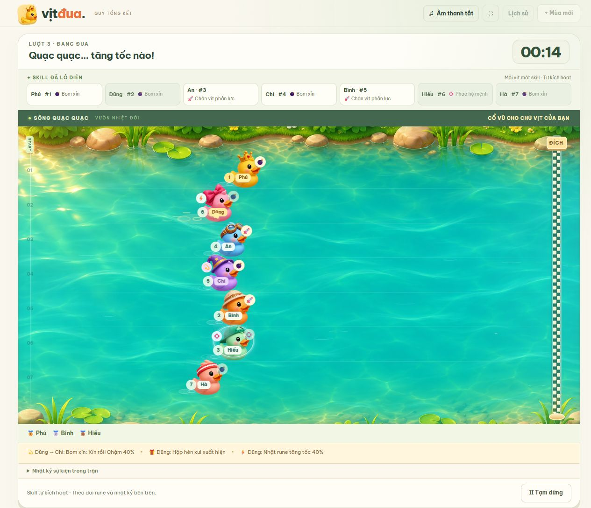

# 🦆 Vịt Đua · Quỹ Mùa Giải

Game đua vịt tiếng Việt cho 3–100 người chơi trên một màn hình chung. Mỗi vòng, mỗi con vịt được chia một skill và một đặc tính, hiện ngay trên thẻ vịt; mỗi người chọn một con theo bộ đôi đó. Lật thuyền, vấp đá, bay vọt, đổi đời: thứ hạng đảo liên tục từ đầu đến tận vạch đích.

**[Chơi Vịt Đua trên trình duyệt](https://vit-dua-phu-20261104.hoangbaophu89.chatgpt.site/)**



## Chạy trên máy

Tải repo về rồi mở `dist/index.html` trong trình duyệt. Nếu có Python 3, bạn có thể chạy game qua HTTP từ thư mục gốc của repo bằng lệnh sau.

```sh
python -m http.server 8000 --bind 127.0.0.1 --directory dist
```

Mở [game trên máy](http://127.0.0.1:8000). Dùng cùng trình duyệt và địa chỉ cho các lần chơi tiếp theo để mở lại mùa đã lưu. Game dùng HTML, CSS và JavaScript thuần. Trình duyệt có thể tải phông Be Vietnam Pro từ Google Fonts và dùng phông hệ thống khi ngoại tuyến.

## Bắt đầu mùa và ngày đua

1. Chọn **Mùa mới**, đặt tên mùa, nhập 3–100 người (mỗi dòng một tên riêng biệt) và chọn ngày đầu tiên.
2. Mặc định mỗi ngày có **10 vòng**, mỗi vòng **40 giây**. Có thể đặt 1–100 vòng/ngày và 40–600 giây/vòng khi tạo ngày đó (tối thiểu 40 giây để kịp xem hết hiệu ứng, kể cả khi share màn hình; ngày tạo trước đó giữ độ dài đã đặt).
3. Danh sách người chơi giữ nguyên trong một mùa. Muốn đổi danh sách, chốt mùa đang mở rồi tạo mùa mới.
4. Mùa không giới hạn số ngày. **Ngày đua mới** sử dụng lại danh sách người của mùa và bắt đầu điểm ngày từ 0.
5. Mỗi ngày lịch chỉ có một ngày đua trong mùa. Ngày mới phải sau ngày thi đấu gần nhất; phải hoàn tất ngày đang chơi, kể cả đua phụ, trước khi thêm ngày mới.

## Thứ tự chọn vịt

- Vòng đầu mỗi ngày chọn theo thứ tự danh sách người chơi.
- Từ vòng thứ hai, người **chót vòng trước chọn đầu tiên**, tiếp theo là kế chót, rồi lần lượt lên trên; người về nhất chọn cuối cùng. Dùng kết quả của **vòng vừa đua**, không dùng tổng điểm ngày.
- Chỉ người đang đến lượt được chọn. Mỗi người một vịt, mỗi vịt một chủ; người còn lại chờ đúng lượt.
- **Ngẫu nhiên cho lượt này** chỉ chọn một vịt còn trống cho người đang đến lượt, không tự chọn hết cho cả nhóm.
- **Hoàn tác lựa chọn cuối** chỉ gỡ lựa chọn gần nhất. Có thể hoàn tác nhiều lần rồi chọn lại, nhưng vẫn phải đi theo thứ tự ưu tiên.
- Đua phụ dùng thứ tự từ chót lên nhất của vòng thường cuối cùng, lọc còn những người phải phân định.

## Skill, đặc tính, lật kèo và rune

Các vòng mới dùng cơ chế `chaos-v2`: **chọn đủ vịt → xuất phát mới lộ skill → lật kèo liên tục đến giây cuối**. Mỗi người vẫn chọn lại một vịt mỗi vòng. Không còn thiên phú: chọn vịt không quyết định thắng thua, mọi lợi thế đến từ skill bốc ngẫu nhiên lúc xuất phát. Không thể xem skill rồi hoàn tác lựa chọn.

Mỗi vịt được bốc một skill riêng (không trùng nhau khi có đủ skill; đông hơn thì mỗi skill dùng tối đa `ceil(N / số skill)` lần). `chaos-v2` có 10 skill, `chaos-v3` có 27. Ở `chaos-v3`, skill và đặc tính được chia **trước khi chọn vịt** và hiện trên thẻ vịt (hạt giống chia bài khác với hạt giống trận đua, nên chọn vịt không làm lộ kết quả); trận dùng đúng bộ đã hiện, và phần xem lại lưu kèm bộ đó. Skill tự kích hoạt đúng một lần:

| Skill | Hiệu ứng |
| --- | --- |
| 🪽 Cánh vàng | Bay vượt lên 2–3 con phía trước. Đang dẫn thì bay cao thêm một đoạn. |
| 💣 Thủy lôi | Ném vào con đang dẫn đầu (hoặc hạng 2 nếu mình đang dẫn), lật thuyền đứng yên 2 giây. |
| 🌊 Sóng thần | Top 3 (trừ mình) dạt lùi 4% đường đua, mình lướt sóng tiến 3% trong 1 giây. Bản `chaos-v3`: bức tường nước cuốn top 3 trôi về ngay sau lưng mình. |
| 🔄 Đổi đời | Đổi chỗ với một con đang hơn mình 1–3 bậc. Đang dẫn thì đổi với con kém mình 1–3 bậc, tự tụt! |
| 🚀 Tên lửa | 70% phóng +150% tốc độ trong 1,5 giây, 30% nổ máy tự lật 2 giây. |
| 🪞 Gương phản đòn | Đòn đầu tiên từ skill vịt khác bị dội ngược: kẻ tấn công lãnh đúng cái hại đó. Không ai đánh thì đến giờ chiếu chói con ngay trên mình (chậm 50% trong 1,5 giây).  `chaos-v3`: dội đòn xong còn bật lên vượt 2 con; không ai đánh thì (ô gần cuối khoảng giữa trận) chiếu chói 2 con dẫn đầu còn đánh được, chậm 50% trong 2 giây, rồi bật lên vượt 1 con. |
| 🎣 Cần câu | Kéo con ngay trên mình lùi về chỗ mình rồi vượt lên ngay trước nó. Bản `chaos-v3`: móc con dẫn đầu, giật nó tụt về ngay sau mình. Đang dẫn thì móc bờ kéo mình lên 3%. |
| 🌪️ Lốc xoáy | `chaos-v2`: xáo trộn vị trí của 3 con ngẫu nhiên, có thể gồm cả mình. `chaos-v3`: cuốn 3 con dẫn đầu (trừ mình) lên trời, quăng mỗi con về khoảng cuối đoàn (có thể ra sau cả con chót 2%), rồi quay mòng mòng 0,8 giây; trung bình mỗi con tụt gần 3 bậc. |
| 🍌 Vỏ chuối | Thả tại chỗ; con bám ngay sau chạm tới thì trượt quay vòng 1,5 giây. Đang bét thì ném lên trúng con ngay trên. |
| 🛟 Phao thần | Chặn đòn đầu tiên (skill hoặc sự kiện sông nước) rồi bật lên vượt 1 con (`chaos-v3`: nảy tưng tưng 3 nhịp, vượt 2 con). Không ai đánh thì đến giờ phao bơm hơi đẩy lên vượt 1 con (`chaos-v3`: 2 con). |
| 🧲 Nam châm (`chaos-v3`) | Hút mình lên ngay sau con dẫn đầu; đang nhì thì vọt lên dẫn. |
| ⚡ Sét đánh (`chaos-v3`) | Sét đánh trúng 2 con dẫn đầu (trừ mình), lật thuyền 1,2 giây. |
| 🔃 Lộn đầu đuôi (`chaos-v3`) | Con dẫn đầu và con chót đổi chỗ. Mình đang dẫn thì con nhì đổi với con chót. |
| ⏪ Tua ngược (`chaos-v3`) | Mọi con khác (trừ con có phao/bong bóng/tàng hình) bị tua lùi về chỗ của 1,2 giây trước. |
| ↩️ Bơi ngược (`chaos-v3`) | Hai con dẫn đầu quay đầu bơi ngược chiều 1,5 giây. |
| 🧊 Đóng băng (`chaos-v3`) | Cả sông đóng băng 1 giây, chỉ mình bơi; con có phao/bong bóng không bị đóng băng. |
| 🎯 Tên lửa tầm nhiệt (`chaos-v3`) | Bám đuôi con dẫn đầu rồi nổ, hất nó lùi 4% và lật 1 giây. |
| 🐝 Đàn ong (`chaos-v3`) | Ong đuổi 2 con dẫn đầu, chậm 60% trong 2 giây. |
| 🕳️ Hố đen (`chaos-v3`) | Mở hố đen ngay trên con dẫn đầu (trừ mình): nó xoáy nhỏ dần rồi biến mất, sau đó bị nhả ra sau con chót 1%. Phao, bong bóng, tàng hình chặn được; gương dội ngược thì chính mình bị nuốt. |
| 👻 Tàng hình (`chaos-v3`) | Hóa ma lướt xuyên qua 2 con ngay phía trước (đang dẫn thì nhảy lên 2% và hù con nhì), mỗi con bị xuyên qua hoảng sợ chậm 50% trong 1,2 giây; sau đó 2 giây mọi đòn và sự kiện xuyên qua (trừ cú vấp đá cuối); đứng ngoài lốc xoáy, tua ngược, đóng băng. |
| 🎈 Bóng bay (`chaos-v3`) | Nhấc con dẫn đầu lơ lửng khỏi mặt nước 1,5 giây, đứng yên. |
| 🧨 Bom hẹn giờ (`chaos-v3`) | Gắn bom lên con dẫn đầu (trừ mình). Bom luôn nằm trên con đang dẫn: ai vượt lên thì ôm bom. 2,5 giây sau (luôn trước vạch đích 0,3 giây) bom nổ trên con đang dẫn lúc đó: hất lùi 5%, lật 1,2 giây. Cú vấp đá sát đích tháo hết bom. |
| 🦝 Đạo chích (`chaos-v3`) | Học lỏm skill chủ động vừa được vịt khác dùng gần nhất và tung lại ngay cho mình (chưa ai dùng thì lấy ngẫu nhiên). |
| 🎲 Xúc xắc (`chaos-v3`) | Gieo 1–6: ra 1 tự lật 1 giây; 2–5 vượt 1–4 con; ra 6 vọt lên dẫn đầu. Đang dẫn thì nhảy lên thêm 0,6% × số điểm. |
| 💤 Ru ngủ (`chaos-v3`) | Mọi con trong tầm 6% quanh mình (ít nhất 2 con gần nhất) ngủ gật đứng yên 1,5 giây; con có phao, bong bóng, tàng hình không bị. |
| 🪄 Biến ếch (`chaos-v3`) | Biến con dẫn đầu còn đánh được thành ếch 2 giây, nhảy chậm còn 45%. Gương dội ngược được. |
| 🍄 Nấm khổng lồ (`chaos-v3`) | Hóa khổng lồ 2 giây, nhanh hơn 35%; tối đa 3 con ngay phía trước trong tầm 5% bị giẫm lùi 2% và quay 0,6 giây. |

Mỗi trận còn có 2–4 **sự kiện sông nước** (nhân theo `ceil(N / 7)` khi đông vịt):

- 🪨 **Vấp đá:** con đang dẫn vấp ngã, đứng yên 1,5 giây. 70% rơi vào 3 giây cuối.
- 🐊 **Cá sấu đớp:** một con ngẫu nhiên bị kéo lùi 5%.
- 💨 **Gió thuận:** con đang bét được đẩy lên 6% trong 1 giây.
- 🌀 **Xoáy nước:** một con ngẫu nhiên quay tròn tại chỗ 1,5 giây.
- 🐬 **Cá heo cõng:** một con ở nửa cuối được cõng lên 5% trong 1 giây.
- 🦛 **Hà mã trồi lên** (`chaos-v3`): một con ở nửa trên bị hất lùi 3% và lật 1 giây.
- 🪵 **Khúc gỗ trôi** (`chaos-v3`): chắn con đang dẫn, chậm 90% trong 1,5 giây.
- 🐸 **Ếch bật nhảy** (`chaos-v3`): một con ở nửa cuối nhảy cóc lên 3%.

**Lịch lật kèo:** pha lật kèo (skill hoặc sự kiện) rải từ giây thứ 2 đến cuối trận, càng về cuối càng dày, và vòng nào cũng có ít nhất một pha ở 1/3 đầu và một pha trong 2 giây cuối. Hai pha cách nhau ít nhất 0,4 giây; khi quá đông vịt khoảng cách co lại và banner gộp "N pha liên tiếp!".

**Nhịp trận `chaos-v3`:** skill và sự kiện rải đều từ khoảng 1/8 đến 3/4 chặng đua (trận 30 giây: từ khoảng giây thứ 4 đến giây 22): mỗi pha một ô thời gian bằng nhau, thứ tự ngẫu nhiên, chỉ lệch trong phạm vi vẫn giữ hai pha cách nhau ít nhất 2 giây, nên hiệu ứng pha trước diễn xong mới tới pha sau. Đoàn quá đông hoặc trận ngắn không đủ chỗ thì khoảng cách co lại cho vừa nhưng vẫn đều nhau. Ô của Gương và Phao xếp cuối khoảng giữa trận, để hai skill này có gần cả trận chờ phản đòn; nếu đã phản ứng sớm thì ô đó để trống thành một quãng lặng ngắn trước 1/4 cuối. 1/4 cuối chỉ có 1 pha lật kèo, lấy từ các skill đánh vào con dẫn đầu (Thủy lôi, Tên lửa tầm nhiệt, Sét đánh, Hố đen, Cần câu, Bom hẹn giờ, Biến ếch), cộng cú vấp đá sát đích ở khoảng 40% số trận. Các skill tự đẩy mình lên hoặc đảo cả tốp đầu (Cánh vàng, Đổi đời, Nam châm, Tua ngược, Sóng thần, Lộn đầu đuôi, Lốc xoáy) chỉ bung giữa trận, vì để cuối trận thì gần như quyết định luôn người thắng. Đoàn nhỏ không ai có skill lật kèo thì pha cuối lấy từ skill khác, nhưng không bao giờ là Lốc xoáy. Sóng thần hất lùi ít nhất 7%, Cần câu giật con dẫn đầu lùi ít nhất 6%.

**⚡ Hiệu ứng nhanh (mặc định) và 🐢 Hiệu ứng chậm:** mặc định mỗi pha camera **zoom vụt vào** chỗ xảy ra (0,16 giây), đòn trúng thì **khựng hình** 0,11 giây, màn hình chớp sáng và rung, vịt bị trúng nháy trắng, rồi pha đó chiếu chậm **1,2 giây** trước khi zoom ra. Mọi skill và sự kiện đều có lớp va chạm chung: tia tốc độ kiểu anime tỏa ra, sóng xung kích hai lớp và tia lửa bắn, cộng icon bật to trên quầng sáng. Share màn hình qua Teams bị giật thì bấm nút **⚡ Hiệu ứng nhanh** cạnh nút âm thanh để chuyển sang **🐢 Hiệu ứng chậm**: mỗi pha chiếu chậm 3 giây, không zoom, không rung, không khựng hình, hiệu ứng vẽ nhẹ hơn. Lựa chọn được nhớ trên trình duyệt đó. Kết quả trận không đổi.

**Đặc tính (`chaos-v3`):** mỗi vịt còn một đặc tính (không trùng nhau khi đủ 8), hiện trên thẻ vịt cạnh skill và thành biểu tượng nhỏ cạnh vịt trên đường đua:

| Đặc tính | Tác dụng |
| --- | --- |
| 💪 Bền bỉ | Nhanh hơn 3,5% suốt trận. |
| 🏃 Xuất phát thần tốc | Nhanh hơn 18% trong 1/4 đầu trận. |
| 🏁 Nước rút | Nhanh hơn 7% trong 1/5 cuối trận. |
| 🔥 Bám đuổi | Nhanh hơn 8% khi đang ở nửa sau đoàn. |
| 🦾 Lì đòn | Bị lật, choáng, làm chậm ngắn hơn 40%. |
| 🤸 Né đòn | 30% né được đòn skill của vịt khác (không né được hiệu ứng diện rộng). |
| 🍀 Tốt số | 75% thoát nạn sự kiện sông nước xấu (và hộp hên xui xấu). |
| 😤 Phục thù | Hết bị lật/choáng thì lao lên thêm 2,5% trong 1 giây. |

Test cân bằng chạy 5.000 trận 7 vịt × 40 giây: người có đặc tính nào cũng thắng trong khoảng 0,7–1,3 lần mức công bằng.

**Badge vượt mặt:** mỗi pha giúp vịt tiến lên (bay, nam châm, phao, ếch, gió, cá heo, tên lửa, tàng hình…) hiện nhãn **⏩ VƯỢT +N** trên đầu vịt khi pha đó xong, nên nhìn là biết vừa vượt bao nhiêu con. Vịt đang tăng tốc kéo theo bóng mờ và vệt tốc độ.

**Vịt trượt theo hiệu ứng:** trong mô phỏng, các cú dịch chuyển (sóng, câu, tua, đổi chỗ, bay…) là tức thì; trên màn hình vịt trượt mượt tới vị trí mới trong lúc slow motion, nên thấy rõ bị sóng cuốn, bị dây câu kéo về, bị tua ngược. Kết quả không đổi.

Vịt đang bị lật hay quay tròn không bị cộng dồn; hết hiệu ứng có 1 giây miễn nhiễm, nhưng vẫn có thể bị đổi chỗ. Ở `chaos-v3`, đòn chỉ làm choáng (Thủy lôi, Sét đánh, Bóng bay, Đàn ong, Bơi ngược, gương chiếu chói, vấp đá, khúc gỗ) bỏ qua con đang choáng hoặc đang miễn nhiễm và nhắm con cao nhất còn đánh được, nên gần như không đòn nào rơi vào khoảng trống. Phao và bong bóng chặn được cả sự kiện sông nước; gương chỉ dội đòn từ skill vịt khác, không dội Lốc xoáy hay sự kiện. Vịt có phao hoặc bong bóng đứng ngoài Lốc xoáy.

Rune xuất hiện ở các làn ngẫu nhiên, không ưu tiên vịt dẫn đầu. Có ít nhất 3 rune mỗi trận: **Nước tăng lực** (+40% trong 1,5 giây), **Bong bóng bảo vệ** (một lần chặn) và **Hộp hên xui** (50% tăng tốc, 50% chậm 40%).

Mỗi pha lật kèo hiện **banner chữ lớn** giữa sông kèm tên người chơi, hoạt ảnh riêng (lật ngửa, quay tròn, bay lên…) và tiếng báo. Nhật ký sự kiện chỉ hiện những gì đã xảy ra; kết quả vòng có phần xem lại skill và diễn biến.

**Cân bằng:** bộ test `tests/chaos-engine-v2-balance.test.cjs` chạy 5.000 trận 7 vịt × 25 giây (`chaos-v3` thêm 30 giây): người cầm skill nào cũng thắng trong khoảng 0,7–1,3 lần mức trung bình; con dẫn đầu lúc còn 3 giây chỉ thắng khoảng 40% số trận.

### Thời tiết (`chaos-v3`)

Mỗi vòng mới bốc một kiểu thời tiết, hiện trên đầu sông và lúc đếm ngược:

| Thời tiết | Tỉ lệ | Ảnh hưởng |
| --- | --- | --- |
| ☀️ Nắng đẹp | 32% | Như bình thường |
| 🌧️ Mưa rào | 20% | Thêm 1 sự kiện; xoáy nước, cá sấu và ếch hay xuất hiện hơn |
| 💨 Gió lớn | 16% | Thêm 1 sự kiện; gió thuận chiếm phần lớn |
| ⛈️ Bão sông | 12% | Thêm 2 sự kiện; xoáy nước, cá sấu và hà mã nhiều gấp đôi |
| 🌫️ Sương mù | 10% | Thêm 1 sự kiện, nhiều khúc gỗ trôi; giấu thứ hạng (số hạng trên vịt và bảng dẫn đầu) đến 5 giây cuối |
| 🌙 Đêm trăng | 10% | Thêm 1 sự kiện, nhiều ếch và hà mã; sông tối, mỗi con vịt có quầng đèn riêng, trăng và sao |

Mặt sông đổi màu theo thời tiết, có mưa rơi, gió thổi và chớp giật khi bão.

`chaos-v3` còn chỉnh hai điểm so với `chaos-v2`:

- **Skill thông minh:** vẫn ngẫu nhiên nhưng nghiêng về con đang dẫn: Đổi đời ưu tiên con cao nhất trong tầm 1–3 bậc (nhất là con đang dẫn), Lốc xoáy luôn cuốn 3 con dẫn đầu, Gương không bị đánh thì chiếu chói thẳng con đang dẫn (con cao nhất chưa bị choáng).
- **Vấp đá sát đích quyết định:** khoảng 40% số trận kết thúc bằng một cú vấp đá trong 2 giây cuối. Đó luôn là pha cuối cùng trong lịch, không chặn được: con đang dẫn ngã ra sau con nhì và nằm lật đến hết giờ, nên chắc chắn không thắng. Các cú vấp đá thường chỉ xảy ra trước 3 giây cuối.

### Slow motion, camera và photo finish

- Mỗi pha lật kèo chiếu chậm 0,15× trong 1,8 giây; camera zoom vào chỗ xảy ra, con vịt liên quan phóng to và phát sáng, màn hình chớp và rung khi có con trúng đòn. Chỉ đồng hồ hiển thị chậm lại, kết quả không đổi; tạm dừng giữ nguyên phần slow motion còn lại.
- Banner chữ đập vào màn hình, từng chữ rơi xuống, có vệt sáng quét qua, tự né sang nửa sông không có pha.
- **Photo finish:** khi con về nhì cách vạch đích dưới 1,5% đường đua, 1,2 giây cuối chiếu chậm với camera zoom vào vạch đích; bảng kết quả có thẻ 📸 PHOTO FINISH.
- Vịt có biểu cảm: 😵 khi bị lật, 🤪 khi quay tròn, 😎 khi bay, 😣 khi bị làm chậm.

### Bình luận viên và âm thanh

- Mỗi pha có một câu bình luận tiếng Việt hiện trên thanh nhỏ ngay dưới mặt sông, không che vịt (`dist/commentary.js`), kèm câu mở màn theo thời tiết và câu chốt khi về đích.
- Âm thanh **bật sẵn** và nhớ lựa chọn bật/tắt trên từng trình duyệt. Trong lúc đua có tiếng nước sông chảy nền; về đích có tiếng reo hò.
- Khi bật âm thanh, câu bình luận được đọc bằng giọng tiếng Việt của trình duyệt (Web Speech) nếu máy có; không có thì chỉ hiện chữ.
- Hiệu ứng âm thanh được tổng hợp bằng Web Audio, không cần file (`dist/sound-fx.js`): nổ nước, đuôi tên lửa, gương "keng", cá sấu đớp, cá heo kêu, vỏ chuối trượt…

### Danh hiệu cuối ngày

Bảng tổng kết ngày trao 4 danh hiệu từ các vòng `chaos-v2`/`chaos-v3` (`dist/awards.js`): 👑 **Vua lật kèo** (vượt nhiều bậc nhất trong 3 giây cuối), 💣 **Sát thủ** (ra đòn trúng nhiều nhất), 🛡️ **Thánh né đòn** (chặn hoặc dội nhiều đòn nhất), 😭 **Kẻ xui nhất** (dính nhiều đòn nhất). Đồng hạng thì cùng nhận; danh hiệu không ai đạt thì bỏ qua. Danh hiệu chỉ để vui, không ảnh hưởng điểm hay quỹ.

## Đua và điểm ngày

Đủ người chọn mới được xuất phát. Đếm ngược 3 giây không tính vào thời gian đua. Có tạm dừng, tiếp tục, âm thanh tùy chọn và toàn màn hình. Phím Space bắt đầu/tạm dừng khi không nhập liệu hoặc dùng nút khác.

Trong **5 giây cuối**, một số vịt được tăng tốc ngẫu nhiên. Cú tăng tốc bổ sung quãng đường thật nên vịt đang cuối vẫn có thể vượt lên thắng. Hiệu ứng vệt nước cho biết vịt nào đang bứt phá.

Với N người, vịt về hạng r mang lại **N − r + 1 điểm** cho người đã chọn. Sau mỗi vòng có bảng kết quả, tổng điểm ngày và thứ tự chọn vòng sau. Mọi người chọn lại vịt ở mỗi vòng.

### ⭐ Ngôi sao hy vọng

Mỗi người có **1 ngôi sao mỗi ngày đua**. Đến lượt mình, bật **Dùng sao lượt này** rồi mới bấm chọn vịt. Vịt có sao mang ⭐ suốt trận và **điểm vòng đó được nhân đôi, về hạng nào cũng vậy** (ngày tạo từ bản này trở đi, luật phiên bản 5). Ngày tạo trước đó (phiên bản 4) giữ luật cũ: chỉ về nửa trên mới nhân đôi, để điểm đã lưu vẫn khớp.

- Hoàn tác lựa chọn cuối gỡ luôn sao đi kèm. Đã xuất phát thì không gỡ được.
- Ai chưa dùng sao thì **vòng cuối của ngày bắt buộc dùng**: nút sao tự bật và khóa lại, kể cả khi chọn vịt ngẫu nhiên.
- Sao không dùng ở đua phụ.
- Điểm có sao cộng thẳng vào tổng ngày, nên ảnh hưởng cả việc ai đóng quỹ. Thứ tự chọn vòng sau vẫn theo thứ hạng vòng vừa đua.
- Bảng kết quả ghi ⭐×2 khi được nhân đôi; CSV có thêm cột Sao.

### 🍀 Bùa may cho người đang thua

Từ vòng 2 của mỗi ngày, ai đang ở **nửa dưới bảng điểm tổng của ngày** được **🍀 cấp 1**, khoảng **1/4 cuối bảng** được **🍀🍀 cấp 2** (đồng hạng thì cùng cấp; đua phụ không có bùa). Bùa đi theo con vịt người đó chọn ở vòng này:

- nhanh hơn 2% mỗi cấp;
- mỗi cấp thêm 30% thoát nạn sự kiện sông nước xấu (vấp đá thường, cá sấu, xoáy nước, hà mã, khúc gỗ); cú vấp đá sát đích thì không né được;
- cá heo, ếch ưu tiên cõng vịt có bùa, rune cũng hay rơi vào làn của vịt có bùa hơn.

Bùa có tác dụng ngầm cho cả nửa dưới bảng, nhưng chỉ người **đang đứng chót bảng** mới hiện 🍀 cạnh tên trong danh sách chọn vịt và cỏ bốn lá cạnh vịt trên đường đua. Đo trên 4.000 trận 7 vịt × 40 giây: vịt 🍀 thắng khoảng 1,25 lần mức công bằng, 🍀🍀 khoảng 1,4 lần. Người đang thua có cơ hội gỡ nhưng không chắc thắng.

## Khoản đóng quỹ cuối ngày

Hết số vòng của ngày:

- Người có tổng điểm **thấp nhất** phải đóng **60.000đ**.
- Người có tổng điểm **thấp thứ hai** phải đóng **40.000đ**.
- Những người còn lại không có khoản phải đóng cho ngày đó.

Nếu đồng điểm ảnh hưởng vị trí chót hoặc kế chót, nhóm liên quan đua phụ. **Hai người cùng thấp điểm nhất cũng phải phân định**, vì cần xác định rõ ai đóng 60k và ai đóng 40k. Người về cuối trong nhóm phân định nhận vị trí thấp hơn; đua phụ không cộng hoặc đổi điểm các vòng thường.

Chỉ khi ngày đã hoàn tất và phân định xong mới ghi **100.000đ phải đóng** vào quỹ mùa. Ngày chưa xong hoặc còn đua phụ chưa ghi khoản nào, kể cả đã biết chắc một người đóng 60k. Tổng quỹ được tính từ kết quả ngày đã lưu, nên F5, mở lại kết quả hoặc xem lại ngày cũ không cộng trùng.

## Quỹ mùa, thu tiền và chốt mùa

**Quỹ mùa giải** hiển thị theo từng người: số ngày hoàn tất, số lần chót/kế chót, tổng phải đóng, đã thu thực tế và còn thiếu. Có danh sách khoản theo từng ngày để đánh dấu **Đã thu** hoặc bỏ dấu nếu cần sửa. Kết quả đua không tự đánh dấu tiền đã được thu; ứng dụng không thực hiện chuyển tiền.

**Chốt mùa** mở bảng tổng kết để kiểm tra trước khi xác nhận. Chỉ chốt khi có ít nhất một ngày hoàn tất và không còn ngày chưa xong. Sau khi chốt, mùa cũ giữ nguyên lịch sử và kết quả, không thêm ngày đua; vẫn có thể cập nhật khoản thực thu còn thiếu. Sau đó mở mùa mới với điểm và quỹ mới bằng 0. Có thể hủy màn hình tạo mùa mới và tạo lại sau.

**Lịch sử** mở lại từng ngày và quỹ các mùa trước. Có CSV cho bảng điểm/chi tiết từng vòng của ngày và CSV cho quỹ mùa cùng từng khoản đóng.

## Lưu và khôi phục

Mùa, ngày, lựa chọn, kết quả và trạng thái thu tiền được lưu bằng **localStorage trên trình duyệt này**, không đồng bộ qua thiết bị hay tài khoản.

- F5 lúc chọn vịt giữ nguyên những lựa chọn hợp lệ và đúng lượt chọn tiếp theo.
- F5 giữa cuộc đua khôi phục cùng vịt, cùng seed mô phỏng và thời gian đã lưu ở trạng thái **tạm dừng**. Bấm **Tiếp tục** để chơi tiếp. Trang lưu định kỳ khoảng 0,5 giây khi đang chạy; thời điểm khôi phục có thể lùi nhẹ so với hình cuối vừa thấy.
- Các vòng mới lưu cả phiên bản mô phỏng; F5 giữ nguyên skill, rune, mục tiêu bom, swap và các lần kháng. Vòng đã xong lưu seed để dựng lại nhật ký, không tính điểm lần nữa.
- Kết quả được ghi đúng một lần cho mỗi mã vòng. Giải mới/ngày mới không xóa lịch sử.
- Nếu trình duyệt không cho lưu hoặc hết dung lượng, game hiện thông báo: giữ trang mở và tải CSV. Nếu dữ liệu lưu không hợp lệ, bản cũ được giữ nguyên và phiên hiện tại không ghi đè.
- Xóa dữ liệu trang web sẽ làm mất lịch sử trên thiết bị đó. Phiên ẩn danh không giữ dữ liệu sau khi đóng toàn bộ cửa sổ của phiên.

### Dữ liệu từ bản trước

Ứng dụng mới dùng khóa `vit-dua-seasons-v3`. Khi chưa có dữ liệu mới, nó đọc dữ liệu bản trước từ `vit-dua-club-v2`, kiểm tra và đưa các giải cũ vào mục **Trước mùa giải**. Khóa gốc bản trước **không bị sửa hoặc xóa**.

Các giải cũ giữ nguyên điểm, kết quả, lựa chọn và cuộc đua đang dở; tiếp tục dùng luật cà phê cũ. Chúng không thuộc quỹ mùa mới và **không bị tính tiền hồi tố**. Quy tắc ưu tiên mới kiểm tra chặt thứ tự lựa chọn của các ngày theo luật mùa mới; lựa chọn dở hợp lệ từ bản cũ vẫn được bảo toàn khi chuyển dữ liệu.

Một cuộc đua mùa giải đã xuất phát trước bản thiên phú vẫn dùng mô phỏng cũ đến hết vòng đó. Trận đang dở và phần xem lại luôn dựng lại bằng đúng phiên bản đã lưu (`chaos-v1`, `chaos-v2` hoặc `chaos-v3`); vòng tiếp theo dùng `chaos-v3`. Test `tests/chaos-engine-v3.test.cjs` khóa kết quả `chaos-v2` bằng mã băm để bảo đảm không đổi. Ngày đua đang chơi dở từ bản trước (phiên bản luật 3) chuyển sang `chaos-v2` cho các vòng còn lại nhưng không có ngôi sao; ngày mới dùng phiên bản luật 4. Các giải cà phê phiên bản 2 tiếp tục dùng mô phỏng cũ trong mọi vòng. Dữ liệu có phiên bản cuộc đua đang dở chưa hỗ trợ sẽ không được tự chạy lại bằng một cơ chế khác hoặc ghi đè.

## Cơ chế mô phỏng

Mỗi vòng có seed ngẫu nhiên từ Web Crypto. Vòng mới dùng `chaos-v3`, tức `chaos-v2` cộng thời tiết (cùng file, xuất ra `DuckChaosEngineV3`). `chaos-v2` (`dist/chaos-engine-v2.js`) tích phân quãng đường theo bước 1/20 giây, gồm vận tốc cơ bản, skill, sự kiện sông nước, rune, tác động lật/quay/chậm và nước rút sin² trong 5 giây cuối. Các cú nhảy vị trí (bay, đổi chỗ, móc câu, lốc xoáy, cá sấu, sóng) thay đổi quãng đường thật ngay tại thời điểm sự kiện, không trượt dần. `chaos-v1` (`dist/chaos-engine.js`) giữ nguyên cho trận và replay cũ. Thứ hạng lấy từ quãng đường cuối, không phải bảng kết quả gán sẵn. Quãng đường được chuẩn hóa để vịt thắng chạm đích ở đúng thời lượng đã chọn.

Tên người chơi và tổng điểm ngày không thay đổi xác suất sự kiện. Các dòng ngẫu nhiên dành cho chuyển động, skill, lịch lật kèo, sự kiện, rune và hiệu ứng được tách riêng; cùng seed và phiên bản luôn dựng lại cùng diễn biến. Không được chỉnh các quy tắc `chaos-v1` hay `chaos-v2` đã phát hành tại chỗ nếu làm đổi kết quả lưu; thay đổi tương lai cần phiên bản mô phỏng mới và giữ bộ đọc cũ.

## Đồ họa và chuyển động

- Bộ vịt dùng chung một ảnh sprite trong `dist/assets/duck-atlas.png`; tên, số vịt và màu nhận diện giữ nguyên. Cảnh sông có nền `river-garden.png`, vùng xuất phát, đích và thứ hạng trực tiếp cạnh từng vịt.
- Khi đua, đường đua mở rộng; thân vịt nổi nhẹ trên nước, nhãn tên và hạng tách khỏi chuyển động của thân để dễ đọc. Vị trí theo `requestAnimationFrame` và nội suy sẵn có của engine, không thêm độ trễ vào quãng đường hay đổi kết quả.
- Lớp `race-visuals.js` chỉ vẽ hiệu ứng: gợn nước, vệt tăng tốc, bom bay, cổng swap, nhặt rune, khiên và pháo giấy cuối lượt. Canvas giới hạn theo vùng nhìn thấy; tạm dừng không tiếp tục chạy hiệu ứng. Khôi phục trận không phát lại các hiệu ứng ngắn đã qua.
- Trình duyệt bật giảm chuyển động sẽ bỏ các hoạt ảnh trang trí; không hỗ trợ Canvas 2D vẫn đua và tính điểm bình thường.
- Cập nhật DOM chỉ khi nhãn/hạng/trạng thái đổi; checkpoint định kỳ vẫn khoảng 0,5 giây nhưng tái sử dụng phần lịch sử đã mã hóa thay vì mã hóa lại toàn bộ mùa mỗi lần. Khóa và định dạng localStorage giữ nguyên; đổi vòng hoặc thay đổi dữ liệu sẽ hủy bộ nhớ đệm checkpoint.

## Kiểm tra và đóng góp

Từ thư mục gốc, chạy các bài kiểm tra mô phỏng, tính điểm và quản lý mùa với Node.js 22 trở lên.

```sh
node --test "tests/*.test.cjs"
```

Để chạy thêm các bài kiểm tra giao diện, vào thư mục `qa`.

```sh
cd qa
npm ci
npm test
```

Bạn có thể mở [issue](https://github.com/hoangbaophu89/vit-dua/issues) để báo lỗi, hoặc gửi pull request kèm cách tái hiện và kết quả kiểm tra. Nếu thay đổi cách tính cuộc đua, hãy giữ khả năng khôi phục các vòng đang chạy từ phiên bản trước.

## Giấy phép

Dự án sử dụng [giấy phép MIT](LICENSE). Hai ảnh trong `dist/assets/` được tạo bằng ImageGen cho Vịt Đua.
